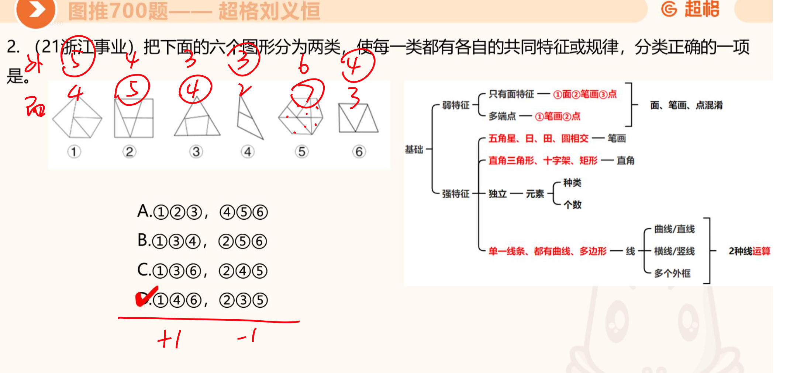
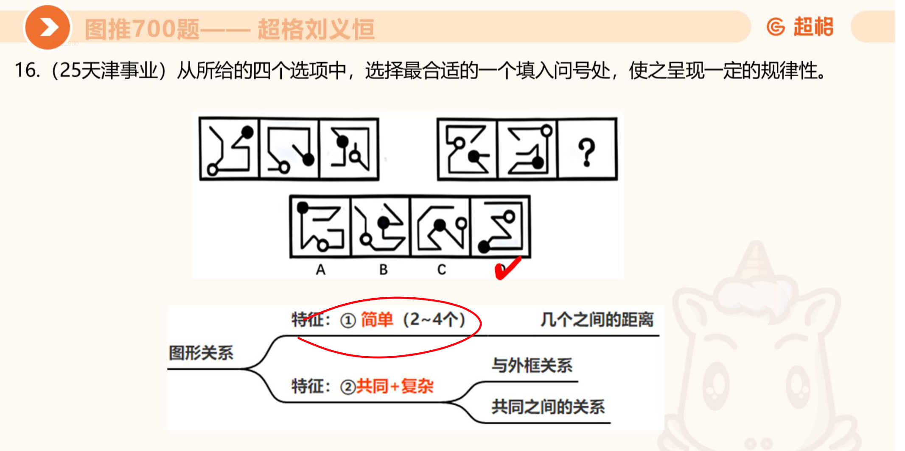
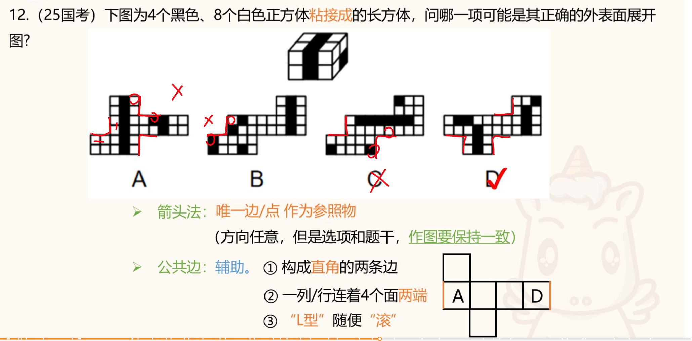
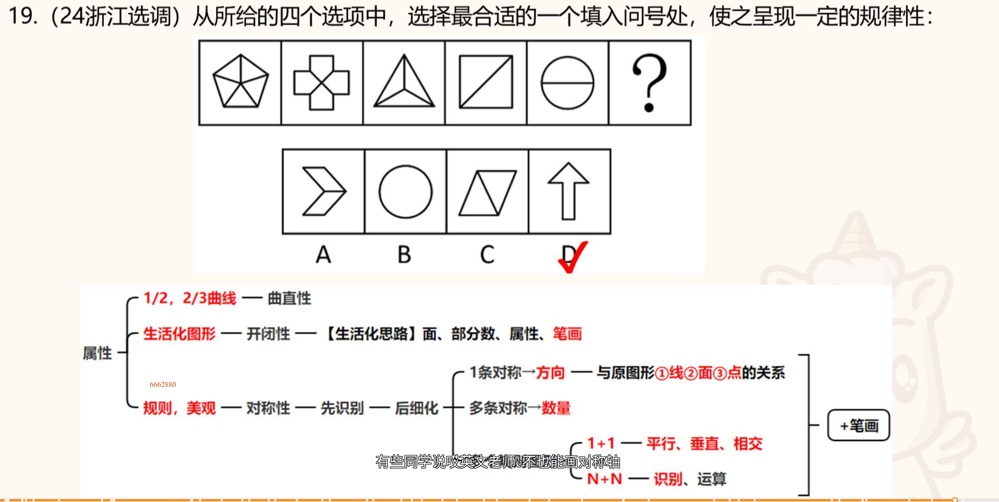

# 图推700重要考点

一定要注意复合考点。

* 外框线数+面数

单个考点考虑行不通的话，那就要去看复合考点，其中这个**外框线数+面数**的复合考点首先被考虑。

* 黑白块之间的距离

出现黑白块两个元素，可以考虑黑白距离

> 如果把【黑白块】换成【曲线】【闭合面】【特殊图案】等元素，也要有意识去看看是否考察的两元素之间的距离。

* 黑白块+黑边数与白面数的关系

属于复合关系，黑块数边，白块数面，再看数量关系。也有可能是其他考法，比如黑块的与外框的公共线、白块与黑块接触的面等关系，考场要注意甄别。

* 截面图

寻找选项中的相似面进行对比。（粉笔36计亦有提及）

* 黑白块立体展开图

看L形是否符合规律，一般来说L形的两条边是公共边，颜色应该一样。

* **对称轴+面/对称轴+笔画数**

复合考点越来越常见。
下面这道题就是对称轴+面。

