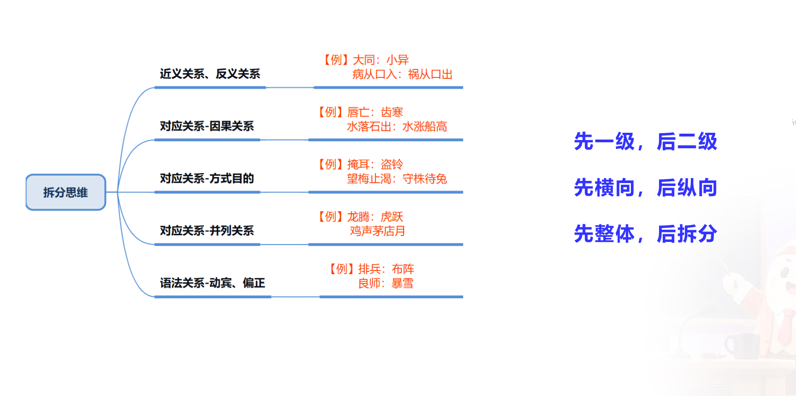

# 36计类比推理

## 动作相关考点

1. 动作先后顺序

2. 方式目的

3. 必要条件/方式

4. 因果关系

一组词语可能不只有一种关系，一种关系行不通时使用另外一种关系去看，考试中**常考的时方式/目的关系**，如果不匹配，换成英国因果关系去看。

### 动作先后顺序

做一件事的流程步骤，造句为“先A后B”。

#### 难点——法律相关

主义刑事诉讼和民事诉讼的立案、起诉位置。

刑事诉讼流程：**立案**、侦察、**起诉**、宣判、收押罪犯

民事诉讼流程：**起诉**、**立案**、审理、判决、执行

#### 难点——二级辨析

1. 动作发出主体是否一致

2. 完整流程闭环/最终好的结果实现 ⭐⭐⭐⭐⭐

### 方式目的

#### 词语特征

偏积极词语，造句：A是为了B。

#### 难点——关系混淆

与因果等其他关系混淆

### 必要条件/方式

题干多为两组词，题干看成动作先后/方式目的都可以，选不出唯一答案，考虑从**必要条件/方式**出发。

### 因果关系

#### 词语特征

偏消极词语，造句“A为了B”、“因为A所以B”

#### 难点

1. 与方式目的其他关系搞混（因果一般负面词语居多）

2. 三组词，并列+因果。

3. 二级辨析：（1）原因是自然、人为。（2）原因/结果是积极/消极

