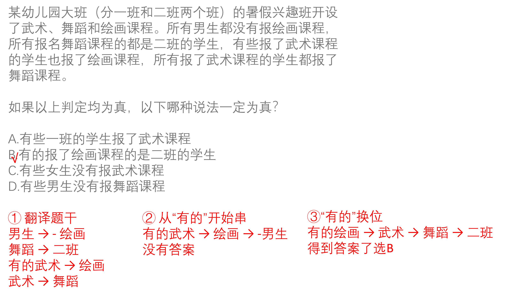
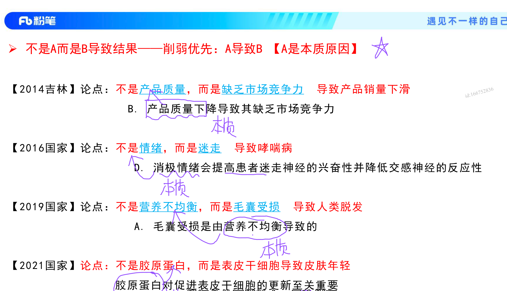

# 题型以及方法

## 所有+有的 推理

解题技巧：

1. 翻译题干

2. 从“有的”开始串

3. 结合换位：有的A是B 可以推出 有的B是A

例题：

## 对比加强

解题技巧：

题干论点是有A有B的形式，比如：“xxx影响了xxx”，那么加强形式就可能会有对比加强：

没A没B，通过对比来加强论点，加大了A与B之间的联系，程度中等。

# 不是A而是B导致结果——削弱优先【A导致B】

如：

不是产品质量，而是缺乏市场竞争力 导致产品销量下滑

削弱：是产品质量导致销量下滑。

