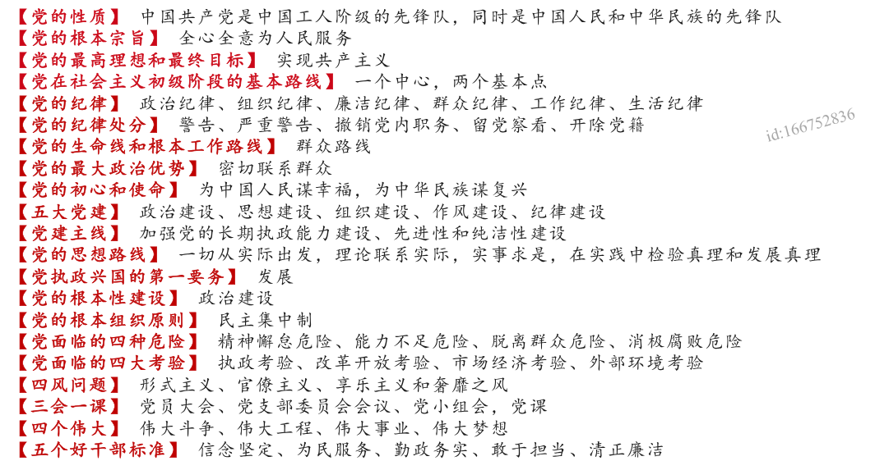

# 政治常识

## 五年规划（计划）

五年计划从1953年开始制定实施；十一五开始，“五年计划”改称“五年规划”。

五年规划的时间：只需要记住十三五是2016~2020，十四五是2021-2025。两个五年恰好落在整十年上。

五年规划一以贯之的主题就是把我国建设成为社会主义现代化国家。

## 我国**国体**与政体

国体：人民民主专政

政体：人民代表大会制度

## 四有干部、四有公民、四有教师、四有军人

四有干部：心中有党、心中有民、心中有责、心中有戒

四有公民：有理想、有道德、有文化、有纪律

四有教师：有理想信念、有道德情操、有扎实学识、有仁爱之心

四有军人：有灵魂、有本事、有血性、有品德

## 高质量发展

高质量发展是建设社会主义现代化国家的**首要任务**

## 中央经济工作会议提出的经济工作总要求、重要方法论

稳中求进，以进促稳，先立后破

## 宪法的制定与修改年份

重新制订（大制定）：1954、1975、1978、1982（我国现行宪法）

部分修改（小修改）：1988、1993、1999、2004、2018。

## 政治常识浏览

