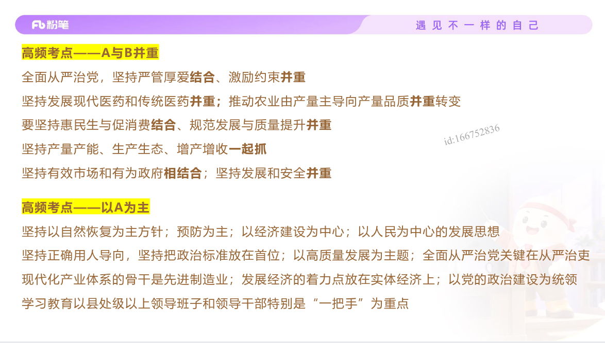

# 政治

## 全国党建工作座谈会

确立习总书记核心地位是什么时候：

::: details 点击展开查看答案
2016年党的十八届六中全会
:::

两个确立、两个维护是什么？

::: details 点击展开查看答案
两个确立：习核心、习思想

两个维护：习核心、党领导

这两个核心、两个维护就是十八届六中全会提出的。
:::

习总书记七大思想

::: details 点击展开查看答案
**军经生外法文党**

习近平强军思想

习近平经济思想

习近平生态文明思想

习近平外交思想

习近平法治思想

习近平文化思想

习近平党建思想

:::

## 庆祝中国共产党成立105周年大会

### "105年不懈奋斗"五大历史贡献

1. （**改变了命运**）从根本上改变了中国人民的前途命运

2. （**开辟了道路**）开辟了实现中华民族伟大复兴的正确道路

3. （**展示了生命力**）展示了马克思主义的强大生命力

4. （**影响了历史进程**）深刻影响了世界历史进程

5. （**锻造了**）锻造了强大的中国共产党

### 六个优秀特质

1. 矢志追求真理，始终把准前进方向——**先进的思想**——把马克思主义作为改造主观世界和客观世界的强大思想武器。

    解放思想（邓），**实事求是（毛）**，与时俱进（三），求真务实（科）。*解放思想是实事求是的前提，实事求是是解放思想的目的*

2. 深深植根人民，始终拥有坚实根基——**坚实的基础**——人民基础。江山就是人民，人民就是江山。

3. 勇担历史使命，始终掌握战略主动

4. 顺应发展潮流，始终走在时代前列

    中国国情——社会主义初级阶段；时代主题——和平与发展

5. 敢于善于斗争，始终保持必胜信心

6. 注重强健自身，始终充满生机活力

### 2022二十大提出的三个务必

1. 务必不忘初心、牢记使命

2. 务必谦虚谨慎、艰苦奋斗

3. 务必敢于斗争、善于斗争

## 坚持落实管党治党政治责任

### 重要措施

1. 健全主体明确、要求清晰的责任体系

    明确**党委（党组）**全面从严治党**主体责任**。

    明确**各级纪委**的**监督责任**。

    明确**党委（党组）书记**的**第一责任人责任**。

    明确领导班子其他成员的管党治党责任。*“一岗双责”——业务与党建*

    明确党员、干部的具体责任

2. 咬住“责任”二字，抓住”问责“这个要害

    对书记的考核，首先要看抓党建的实效

3. 要加强党的建设

## 二十届五中全会（必考）

主题是什么？

::: details 点击展开查看答案
持之以恒推进全面从严治党

（2014年习总书记首次提出“全面从严治党”）
:::

全面从严治党：**基础**在全面，**关键**在严，**要害**在治。

党建的主线：提高党的长期执政能力，保持党的先进行和纯洁性。

> 经济主线：供给侧结构性改革

### 系统部署

1. 增强党性是全面从严治党的根本性任务。

    党性：政治觉悟、立场问题（站在党和人民立场上）

2. 坚持用党的创新理论凝心聚魂

    处理咱自己的问题使用自己的理论（新思想），处理宏观问题就用马克思理论。

3. 民主集中制是党的根本组织原则和领导制度

    重大问题处理的原则（**十六字原则**）：

    ::: details 点击展开查看答案
    **集中领导、民主集中、个别酝酿、会议决定**
    :::

4. 全面从严治党关键在从严治吏。

    高频考点：

5. 党的各级组织是全面从严治党的主体。

6. 正风肃纪是全面从严治党的有力举措。

    > 一句话总结“中央八项规定”：**一切从简**。

    > 党性、党风、党纪是有机整体，**党性是根本、党风是表现，党纪是保障**

7. 一体推进不敢腐不能腐不想腐是全面从严治党的重要方略和反腐败斗争的基本方针。

8. 加强党内法规制度建设是全面从严治党的长远之策、根本之策。必须坚持把党章作为全党的根本行为规范。

9. 持之以恒推进全面从严治党，是全党的共同政治责任。
