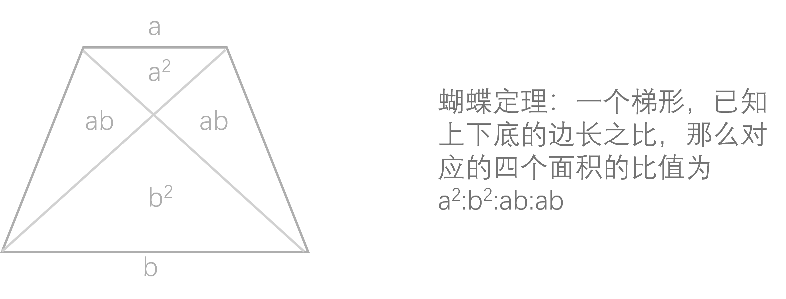

# 平面几何

## 蝴蝶定理

一个梯形，已知上下底的边长之比，那么对应的四个面积的比值为$a^2 : b^2 : ab : ab$

上下两个三角形是相似三角形，左右两个三角形是相等三角形

## 勾股定理

$$
a^2+b^2=c^2
$$

常见勾股数：

3、4、5（衍生6、8、10；9、12、15）

5、12、13

8、15、17

7、24、25

1、√3、2（三角形内角为30°、60°、90°）

√2、√2、2（三角形内角为45°、45°、90°）

## 各个图形面积、周长公式

1. 梯形面积公式：

    $$
    S=\frac{上底+下底}{2}*h
    $$

2. 平行四边形面积：

    $$
    S = 底 * 高
    $$

3. 三角形面积公式

    $$
    S = \frac{1}{2}*底*高
    $$

4. 圆面积和周长

    面积：

    $$
    S=\pi r^2
    $$

    周长：

    $$
    C=2 \pi r
    $$

5. 扇形面积和弧长

    面积（圆面积乘以角度占的份数）：

    $$
    S=\pi r^2 \frac{n}{360}
    $$

    弧长（圆周长乘以角度占的百分比）：

    $$
    C=2 \pi r \frac{n}{360}
    $$
