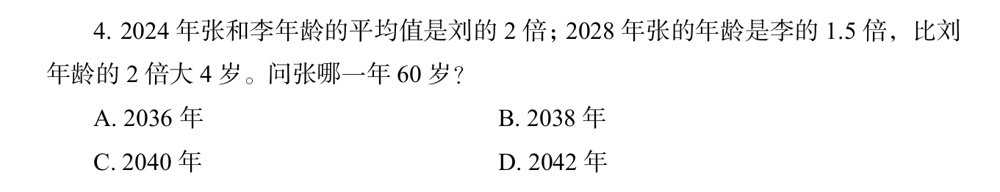

# 年龄问题

题目中给出几个人的年龄，并且给出相应的数据关系。可以根据给出的关系设定未知数。尽量利用好题干中的关系，保持只有一个未知数。

比如2026年国考执法卷的一道题。

可以根据2028年的年龄关系设定未知数。

|年份/人物|张|李|刘|
|--|--|--|--|
|2024|3x-4|2x-4|(3x-4)/2-4|
|2028|3x|2x|(3x-4)/2|

为了保持好计算，可以把分数转换为整数

|年份/人物|张|李|刘|
|--|--|--|--|
|2024|6x-4|4x-4|3x-2-4|
|2028|6x|4x|3x-2|

根据“2024年，张和李的年龄平均值是刘的两倍”可以列方程(张和李加起来的值是刘的4倍)

6x+4x-8=4*(3x-2-4)

2x=16

x=8

所以张2028年年龄是48岁

2040年年满60
