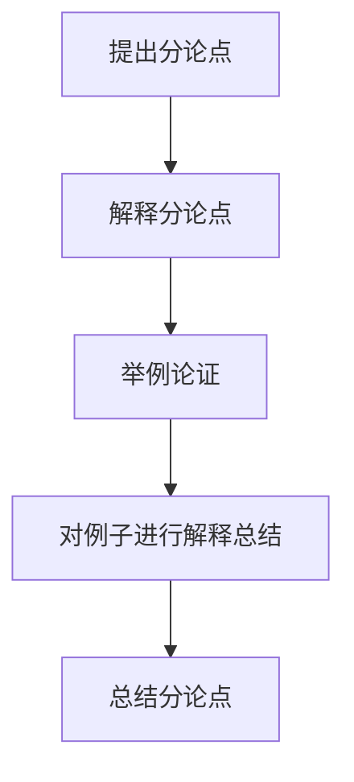

# 申论-作文

最原始的要求：**一切以材料为准**，尽量少添加自己的想法。

申论作文按照我目前的看法的话，都是对策型的作文，即：要做到题干上的要求，就要1.xxx；2.xxx；3.xxx。论证的话，就把分论点挨个论证就好了。

## 流程

1. 立意，根据题目中的话简单立意拟分论点

2. 寻找题干的话出处，根据出处细化分论点

3. 拟定分论点小标题

4. 在材料中提取分论点论据

5. 材料外的例子补充

## 各部分写作方法

### 开头写法

大作文开头**不宜铺垫过长，尽量快速引入总论点**。

#### 释义阐释

将题干中提到的句子进行一番阐释，分析其意义。

结构：:red[题干中心句摘抄]+:blue[解释含义/提出总论点]+:green[提出分论点]

例子：:red[“运用好合适的章法，处理好不同因素之间的关系，是促进事务长远发展的关键。”]:blue[什么是章法呢？“章法”就是要从整体上谋篇布局，谋划一件事要有整体观大局观。好的章法不能是孤立、静止、片面地看问题，而是要联系、发展、全面地谋划，处理好不同因素之间的关系。“合适的章法”，就是要根据事物的发展变化，在不同的关系中去动态调整章法，这就需要处理好各种关系]。:green[就企业发展来说，需要处理好传统与现代、改革与稳定、创新与风险、国内与国际、线下和线上的关系]。

#### 时代背景式

结构：:red[时代大势/政策背景]+:blue[成绩/问题]+:green[总论点+分论点]

例子：:red[数字浪潮奔涌向前，乡村数字化建设持续提速，网络基础设施不断向乡村延伸]。:blue[然而，乡村还面临数字人才匮乏、应用场景偏少、数字鸿沟尚未弥合等挑战]。:green[以数字赋能乡村振兴，需要夯实基建底座、培育乡土人才、做强特色产业，为共同富裕注入数字动能]。

#### 名言开篇法

但是名言开篇总觉得不能很快引入主题。

结构：:red[名言]+:blue[解释]+:green[引出总论点+分论点]

例子：:red[“绿水青山就是金山银山。”] :blue[这一理念深刻阐明生态保护与经济发展并非对立，而是相辅相成。各地生态治理持续发力，生态环境稳步向好，但生态保护压力依旧不容忽视]。:green[走好绿色发展之路，要树牢生态理念、完善制度保障、推动产业转型，实现发展与保护协同共进]。

### 分论点论述方法（豆包总结）

1. 提出分论点

2. 解释分论点

3. 举例论证分论点

4. 总结论点

#### 例证法

结构：:red[分论点] + :blue[案例（材料内 / 积累）]+ :green[分析案例 + 回扣论点]

注意点：优先使用材料中的例子，少**硬堆**名人典故；*分析案例其实和回扣论点其实应该是一个东西吧，我局的可以称之为**总结论点***

例子：分论点:red[城市发展要善于留白]。举例子:blue[某地划定生态缓冲带，不盲目上马商业项目，保留绿地空间，不仅改善人居环境，也为长远发展预留空间]。回扣总结论点:green[可见留白不是不作为，而是着眼长远的治理智慧]。

#### 正反对比论证

结构：:red[分论点] + :blue[正面做法好处] + :blue1[反面做法危害] + :green[对比总结回扣]

注意点：

1. 这种写法会更出彩，应用到了对比，但是就是可能要举两个例子；

2. 还可以用**假设法——假设正面的例子没有这样做**。

3. 还有**同一个案例的前后对比**，前后，今昔，例子中的不同主体等。

例子：

1. 正反双案例：分论点:red[城市治理要善用留白]。正例:blue[某地在新城规划中预留生态廊道，不搞高密度开发，留住绿地空间，既改善人居环境，也为后续文旅产业埋下伏笔]。反例:blue1[反观部分城区一味追求土地开发利用率，挤占公共绿地，高楼密集、空间拥挤，不仅降低居民幸福感，也缺少转型的缓冲空间]。对比总结回扣:green[一留一占的对比充分说明，留白是着眼长远的治理智慧]。

2. 正面案例+反面假设：分论点:red[城市治理要善用留白]。正例:blue[某地在新城规划中预留生态廊道，不搞高密度开发，留住绿地空间，既改善人居环境，也为后续文旅产业埋下伏笔]。反例:blue1[倘若一味追求土地收益，把所有空间全部开发填满，就会压缩生态承载空间，城市失去弹性，难以应对未来发展的变化]。对比总结回扣:green[由此可见，留白是城市可持续发展的必然选择]。

3. 同一个案例前后对比：分论点:red[城市治理要善用留白]。正反例:blue[过去这片区域一味大拆大建，商业项目扎堆，生态空间不断萎缩；如今当地调整思路，划定保护边界，留出缓冲绿地，城市面貌焕然一新]。对比总结回扣:green[转变的背后，正是读懂了留白的价值]。

#### 理证法

结构：:red[分论点] + :blue[阐释内涵 / 意义 / 危害 + 理论分析] + :green[回扣]

注意点：这一类适合哲学、思辨类的文章，*我觉得不好找例子的分论点可以用这个方法吧*；*都是讲理，那么阐释内涵+理论分析可以混为一谈*

例子：分论点:red[城市发展，应当学会留白]。理证:blue[留白不是停滞不前、放弃发展，而是摒弃 “填满即繁荣” 的粗放思维，统筹当下建设与长远承载力。城市的资源、生态、公共空间都有上限，开发没有节制，就会透支发展潜力；适度预留空间，才能给生态修复、民生升级、未来转型留下余地]。回扣论点:green[由此可见，留白是可持续发展的治理智慧]。

### 结尾写法

## 可以使用的万能句式

### 开头

### 论证时的句式

1. 对仗式：A是B的XX（价值型）

    ____是____的题中应有之义；____是____的内在要求；____是____的坚实根基。

2. 二元辩证：既要...也要...

    推进____，既要把握____的速度，也要守住____的温度；既要立说立行抓落实，也要久久为功谋长远。

## 抄材料方法

1. 把前面材料中的内容精炼总结提炼到作文中作为例子。

## 进阶

高级一点的写法：每个材料抄三句话，排比句式。
比如：todo!

主体+做法+结果

## 注意

1. 论点是偏客观的（主论点、分论点都是），其论点之外的内容可以主观发挥。

2. 没有好写的例子，可以使用范例去写：也就是不指名道姓的写是谁，就写是哪些人，比如：“从扎根乡土、久久为功的基层干部，把青春奉献给民生实事...”
