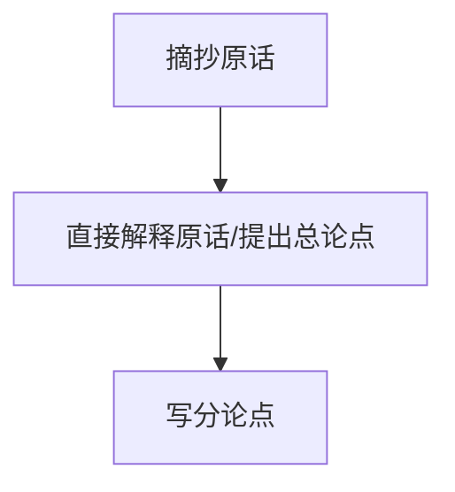
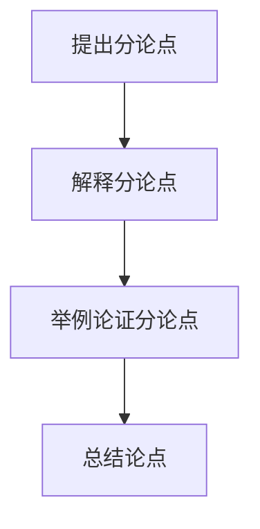

# 张小龙申论大作文谈想

## 做题步骤

1. 给定一句话，简单理解意思。

2. 返回材料，粗读一遍，大概讲了些什么事，最好和给定句子建立连接。

3. 精读材料，从材料中提取逻辑和例子

4. 打提纲，梳理逻辑

## 不必要的事

1. 没必要在考场抓耳挠腮的起一个漂亮的标题

2. 没必要把每个分论点句子写得很高大上、整齐

3. 尽量在第一段把观点亮出来，不要铺垫太多语句

4. 从材料中提取逻辑和例子不要太细致

## 各部分写法

### 开头

1. 抄原话

2. 直接解释原话/提出总论点：这一步解释原话其实就相当于提出总论点了。

3. 写分论点：把分论点组织一下一起列出来。

### 分论点

提出分论点+进一步解释+依据材料例子和逻辑

1. 提出分论点

2. 解释分论点

3. 举例论证分论点

4. 总结论点

### 结尾
