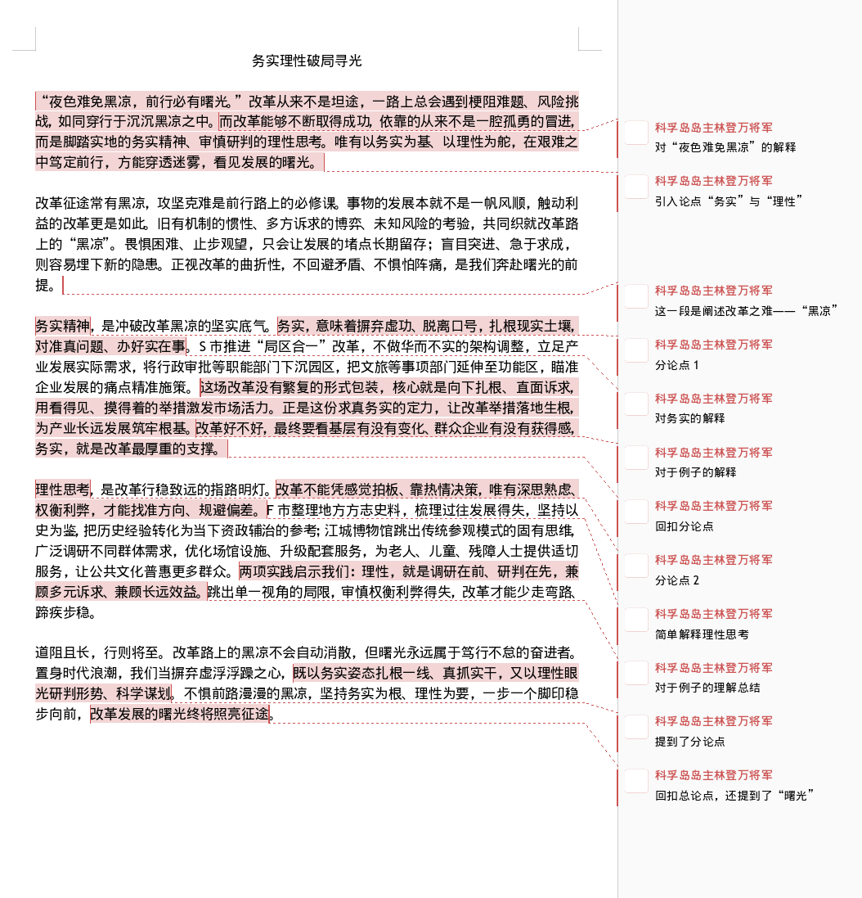

# 2021国考副省作文——改革黑凉（豆包修改版）

## 破烂版如下

务实理性破局寻光

"夜色难免黑凉，前行必有曙光。"改革的路总是曲折的，但只要敢于去做并且善于去做，一定会看到成功的曙光。要斩开前行路上的荆棘，需要掌握正确的方法与路径。首先要改变过去的思想才能找到正确的方向，然后以务实的精实神打好整体的基础，还要以理性的思考稳步地前行。

改变思想是改革的先行兵，纠正过去错误的思想，才能在浩浩荡荡的改革中把稳前进的船舵。改革开放初期，全中国的思想都还停留在过去那种阶级斗争之中，干事束手束脚，导致很多政策法令不能彻底落实，邓小平同志以"解放思想，实事求是"的指导思想及时纠正了过去陈旧且错误的思想，为改革开放找准了方向，打消了基层干事创业的顾虑。为什么思想需要改变？古语有云："谋定而后动。"改革做事之前，一定要把思想问题解决，这样改革的方向才会精准无误，改革的动力才会源源不绝，改革的进程才会蹄疾步稳。

务实精神是改革的承重盘，改革的基础是一定要落在务实精神上的，不能搞假大空，不能只喊口号不做实事。S市实行"局区合一"改革，充分发挥务实精神，把行政审批局等与产业发展相关的部门作为职能局下沉到产业园区，把文体旅游局等部门作为事项局延伸功能区，只做对产业发展有益的，直接解决产业发展中存在的问题，激发了企业内生动力，为S市产业发展的长远发展打好了基础。务实精神，就是要求我们要深入了解基层需求，解决实实在在的问题，把改革落到实处，落到基层最广大的地方。

理性思考是改革的方向盘，改革的路是曲折的，是充满荆棘的，但改革一定是向上的。在改革这条路上，需要我们把好方向盘，踩好离合器，整步地向上攀登。F市的地方志编纂工作，通过对本地区的县志等历史史料进行整理收集后，充分总结思考其中的得失，以古鉴今，为地方发展提供经济建设方面的资政功能；江城市博物馆对以视觉为中心的参观感受进行广泛思考后改革自身服务与设施为小朋友、残疾人等多个特殊群体提供贴心的服务，大大提高了人们参观博物馆的体验。只有经过审慎的思考，改革才能走在正确的方向上，为人民提供更好的服务，为发展提供更精准的动力。

在改革的道路上，正确的思想是改革的重要动力，务实精神是改革植根的基础，理性的思考是改革前行道路上的方向指引，只有把这三者作为有机的结合，改革才能蹄疾步稳，滚滚向前。
