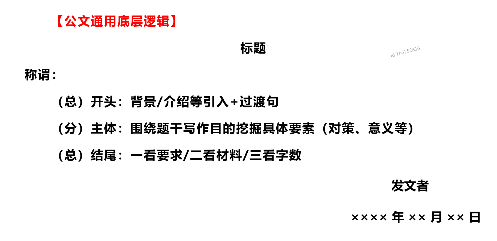
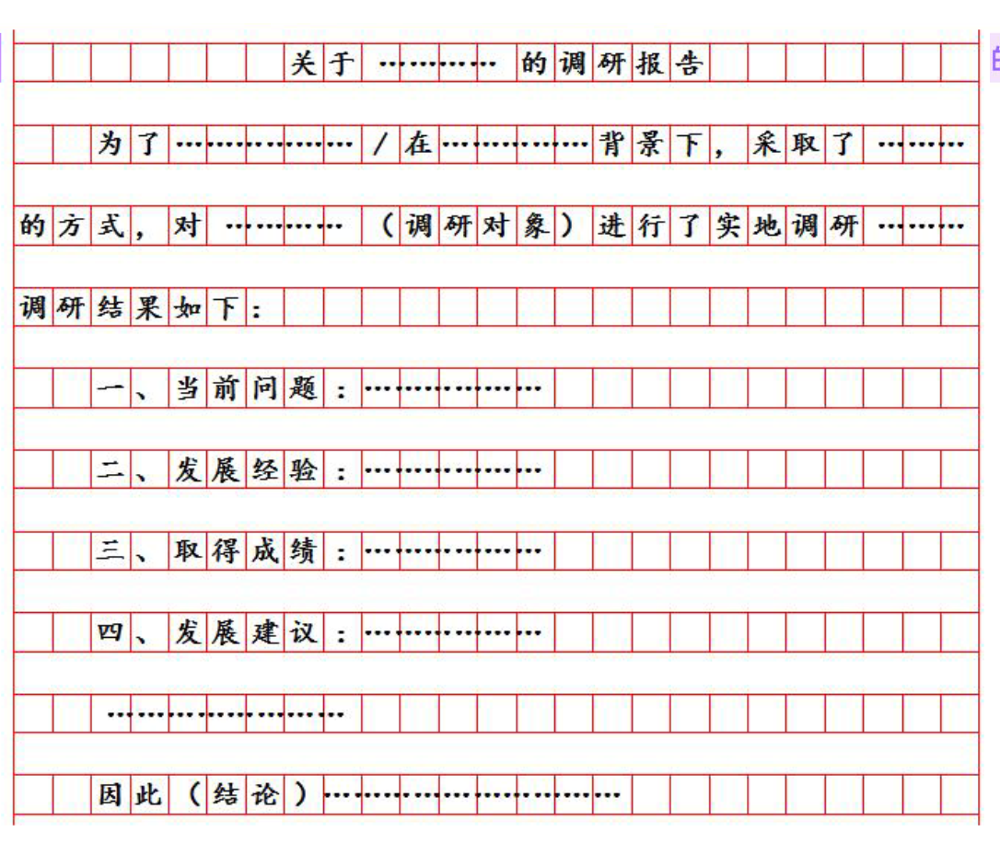
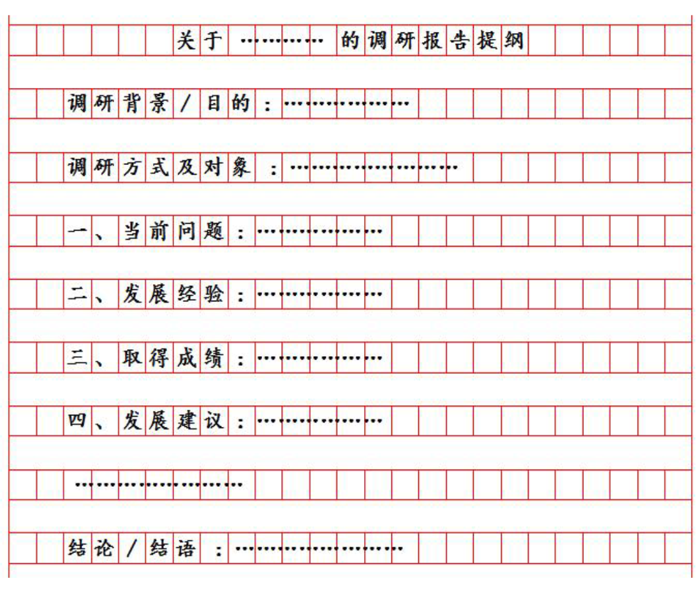
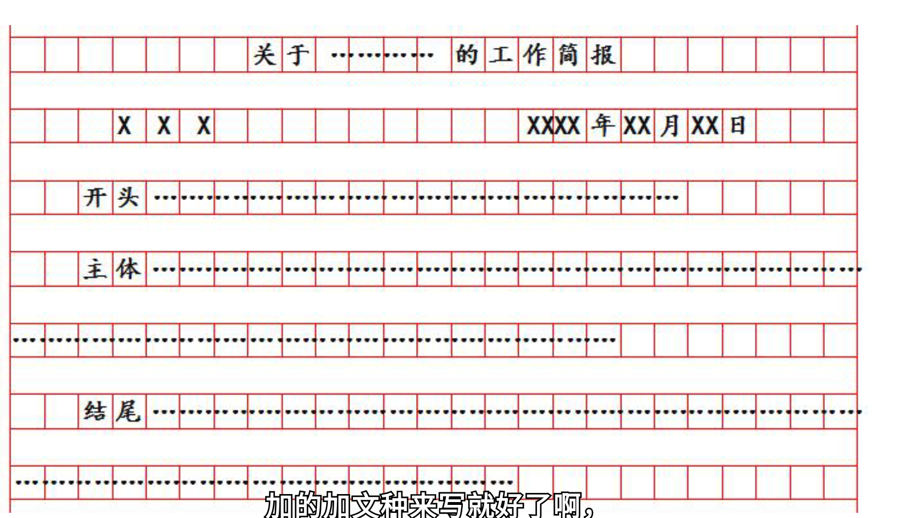

# 公文

核心还是要尊重材料！！！材料永远是第一位的。

## 答题格式

申论整体的写作格式见[申论写作格式](../写作格式.md)

不同文种对应不同格式。

公文题都有差不多的通用写作格式，如下：

标题：第一行居中写。

称谓：第二行顶格写，就是面向对象。

落款——发文者：写这篇文章的身份，根据材料中来，不可暴露真实信息。

落款——时间：可以用 xxxx年xx月xx日 来代替，请注意，每两个数字占一个格子，右边空四个格子。

内容：分为三个部分，开头（背景/介绍等引入+过渡句）、主体（根据题干挖掘具体要素，对策、意义等）、结尾（一看要求：有感染力、有号召力，需要写结尾；二看材料：材料中有总结性语言，就要写结尾；三看字数：字数没达标，就要写结尾凑字数，没有字数来写结尾了就不写）。三个部分首句空两格。

写作格式：

公文题必须分段，可以分为三段（背景、经验、结尾）。

标序号选择大写的一二三。

> 过渡句万能句：**具体介绍如下：**

> 对策题目中不写数字，公文题中可以写数字

## 答题方法

公文题与对策题一样，文章需要读多遍，第一遍通读梳理要点，第二遍精读提取信息组织答案。

公文题还要多读一遍：打草稿、列提纲。这一部分，主要就是梳理第二遍精读提取信息后的逻辑提取。

遇到关键的句子太长的，要学会缩句或者归纳。全面比全点重要，做到“面面俱到，点到为止”。

## 内容要素

## 逻辑分类

跟对策题一样保持一致，尽量从材料中提取信息、词语、逻辑。

跟对策不一样的是，公文题前置词尽量都写。

## 小众公文

1. 指定多种作答要素/结构：要点分散，要点要写全

2. 指定单一重点作答要素：根据题干要求，注意审题，根据题干要表达的信息来作答

3. 不指定作答要素，就根据材料来就可以了。

## 公文分类

### 1. 讲话稿/发言稿/讲话提纲/发言提纲

#### 讲话稿/发言稿

这一类听名字就比较正式一点

格式：标题+称谓；不需要落款

内容：结合应用场景，开头可以寒暄：“大家好，非常荣幸...”等，不可过长，一句话即可；结合应用场景，材料中有生动形象的表达，可以直接抄在答案中，无需概括规范词。

#### 讲话提纲/发言提纲

这一类就没那么正式了。

格式：标题（不需要称谓、落款）

内容：保险起见，提炼出“要素信息”作为小标签前置，呈现纲目式。

何为要素信息：就是你这一段文字在写什么，比如在写背景，就在第一段前写一个“背景：”作为小标签。通常写背景、经验/成绩/建议、结语三部分。

### 2. 调研报告/调研报告提纲

格式：只有标题（不要称谓、落款），写法为“关于...的调研报告”

内容：符合一般公文的逻辑，开头——主体——结尾。

开头：背景/目的+调研方式、调研对象+过渡句

主体：按阶段分条写，注意标记小标签，比如“一、当前问题....二、发展经验....”。主体每一条都要分段。

结尾：得出结论

如果是提纲的话，小标签就需要改一下，见下图。

通用格式如下（主体部分内容取决于材料）：

**调研报告**：

**调研报告提纲**

### 3. 建议/意见

格式：标题+称谓+落款（个人or组织，根据题干确定）

内容：

开头：多以问题、意义作引入，问题简单总结即可。背景/介绍+过渡句

主体：重点写对策。

结尾：可以补上：以上建议请审阅。

#### 做题方法

题型是写建议，但是要写建议需要根据问题来做建议，所以需要在文中提取遇到的问题，如果提到了对策，顺便提取出来并和问题做一个对应。材料中没有对策的，需要根据问题来反推对策，这一步可以在列提纲时一起做了。

文章主题是建议，所以问题需要放在第一段背景中简略阐述。在主体中分条列出建议。

### 4. 汇报/汇报提纲

* 汇报

格式：

（书面工作汇报）标题+称谓+落款；

（口头工作汇报）标题+称谓；

（官方网站公开汇报）标题+落款

内容：

开头+主体+结尾

* 汇报提纲

格式：标题

内容：每段前面需要标注要素小标签。

### 5. 案例介绍材料/参评材料/推荐材料

* 案例介绍材料

用途：存入案例库、内部学习等。

格式：标题

内容：开头+主体+结尾，主体以做法、意义为主；如有问题，也可以作为开头引入

语言：客观平实，叙述诚实，把事情讲明白。

* 参评材料/推荐材料

用途：向上级部门推荐、或参加评比评审。

格式：1️⃣有写作对像：标题+称谓+落款 2️⃣无写作对象：标题+落款

内容：开头+主体+结尾

语言：正式，“推荐理由如下”、“特此推荐”过渡句。

### 6. 处理新文种

遇见没见过的新文种，需要去判断使用的格式。

1. 文种特点：书面的就要写全格式（标题、称谓、落款）；非书面化的就只用写标题。

2. 题干线索提示：明确给了写作对象（写作身份）的，就要写称谓（落款）

3. 结合生活常识

### 7. 公开信/回信

* 格式

标题+称谓+落款

标题：致xxx的一封信/公开信/一封公开信

* 内容

开头+主体+结尾

回信：开头需要加感谢你的来信.../你的来信已收到...

危机公关类：介绍背景+表态+解释+做法+结尾

#### 怎么写

1. 做法有对有错，就要解释对的一面是什么，解释问题在哪里

2. 做法纯错，背景+表态后直接写做法。

### 8. 短评/时评

就类似于小作文。前置词不必高大上，抓住点即可。

* 格式

只写标题。但是标题必须自拟（标题需要包含主体、核心观点）

* 内容

开头+主体+结尾

开头：背景介绍+表达观点

主体：直接分段书写，不标序号。

### 9. 倡议书

格式：标题+称谓+落款；标题中最好包含“倡议书”

内容：开头+主体+结尾

---------------

开头：倡议书的背景；“威逼利诱”——关于这件事的坏处，关于这件事的好处；过渡句

主体：结合**题干的写作目的**，“威逼利诱”，倡议做法。

结尾：必须要有呼吁号召

### 10. 案例摘要

格式：只需要标题

内容：开头+主体（不需要结尾）

主体内容以题目要求为准，一般为做法和意义。

### 11. 工作简报

格式：与其他文种格式不同，如下：

### 12. 宣传稿/报道/新闻稿/宣传报道稿

#### 宣传稿

格式：

* 登广告、发网站：标题（大多数的格式都是这个）

* 贴公告：标题+称谓+落款

内容：

开头：背景、介绍+过渡句

主体：问题+总体做法+意义

结尾：升华

#### 报道/新闻稿

* 身为报社记者：标题+开头【开头第一句写：本报讯（记者XXX）】

* 非记者，仅仅内部宣传等：标题，无“本报讯”

### 13. 内容提纲

小众文体

格式：标题

（提纲）内容需要加小标签

### 14. 公文和单一题的区别

题目审清，是围绕其中几个点写一篇公文，还是只写公文中的某几个方面，另外必须按照题干给定内容确定层次分类。

### 15. 推介稿

类似于宣传稿和发言稿

#### 口头推介稿

上台宣讲、现场发言

格式：标题+称谓（类似于发言稿）

内容：开头（背景引入、介绍推介介绍、推介目的）

主体：介绍优势、特色、价值、亮点

结尾：发出邀约、展望

#### 书面推介稿

宣传材料、推介手册

格式：标题

内容：开头（背景引入、介绍推介介绍、推介目的）

主体：介绍优势、特色、价值、亮点

结尾：发出邀约、展望

### 16. 公文格式要求

什么情况下不需要写格式：

1. 只需作答公文的某部分内容，而非完整公文

2. 题干要求“不考虑格式”
