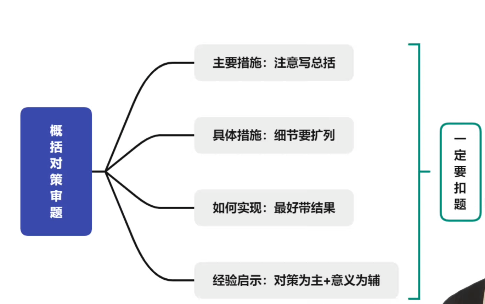
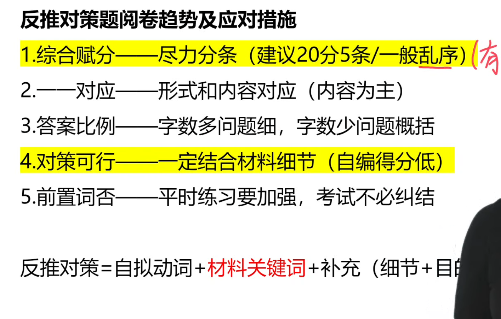

# 对策

**小题理清逻辑**

## 前置词

即中心主旨词（总括词）。

一般而言，位置写在哪不影响得分。

### 必写前置词的情况

1. 题干中提到“哪些方面”“哪些角度”等提示

2. 题干中一般为概括主要做法

3. 要求中提到“重点突出”“观点明确”

### 可写可不写

题干中有“条理清晰”“有条理”“层次清晰”，可写可不写。

### 快速找到中心主旨

1. 总括句/总结句/首尾句

2. 高频出现的词语

3. 这个/都/其本质......后面跟的内容

## 材料

答案主体基本都来自于材料

### 有意位移

有意位移的段落，也要归纳到对应的要点之内

## 题干

注意题干审题

## 考场方法

答题步骤：

1. 通读材料，勾画材料，简略的总结文章分层。

2. 根据题干要求，从文章中提取关键词组织答案。

3. 根据字数要求，将关键词组织成结构。

注意：

1. 顺着题干和**材料**去梳理**逻辑与要点**，需要第一遍宏观阅读与第二遍细读。

2. 面面俱到、点到为止，需要找出所有提到的面，但是点到为止不要写多内容（写做法，就要丢掉结果），写多不得分。

3. 注意**关键词**，这是得分的重要因素。

4. 如果题干中提到“如何”“如何实现”等词语，应该带上一点结果的语句。

5. 一堆做法案例后跟了一个总结，可以直接抄这个总结。

6. 每一个点之中，注意“明珠”与“土豆”，以具体事例来呈现的，不用写示例主体，把做法写好就行。

7. 材料中提到了做法，还要注意主语是谁，跟题干的主语是否符合。

## 答题格式

总的写作格式见[申论写作格式](../写作格式.md)。

1. 对策题分条不用换行。

2. 使用小写数字标注条数，如“1.”“2.”“3.”，写在一个格子里。

## 问题反推对策题

问题反推对策：第一步梳理问题，第二部根据问题提出建议。

提建议的时候，注意建议是否可执行的，即根据题目暗示，从文中找内容有没有具体的措施。

> 第二条中，“一一对应”可以分条后按问题+对策来写（内容+形式都对应上了），也可以统一写完问题再写对策（内容对应上了）。

**每个建议在文种很可能都有细节的暗示**

**反推对策=自拟动词+材料关键词+补充（细节+目的意义）**
