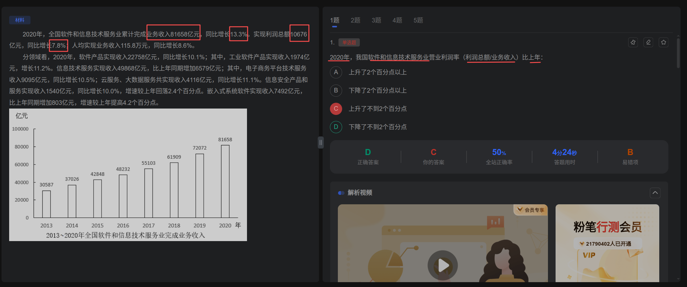

# 常见考察点题型和方法公式

主要对考试中出现的题型进行总结。并对该题型给出公式和方法。

## 比重差

问法：比上年差多少个百分点

公式：$比重差=\frac{A}{B}*\frac{a-b}{1+a}$

解法：直接把题中的值代入就行了。这里就是$\frac{10676}{81658}*\frac{8.6\%-13.3\%}{1\%+13.3\%}=\frac{1}{8}*\frac{-5.5\%}{1.13}$；直接估算5.5%*1/8肯定都是小于2%的了。

## 平均值

## 保持增量不变
