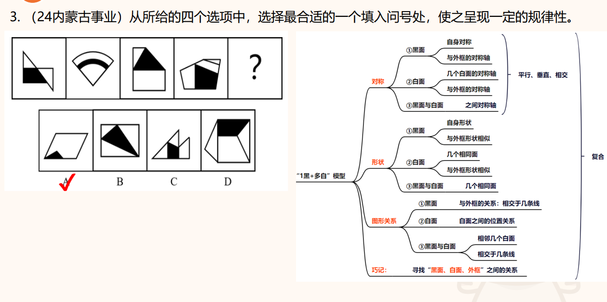
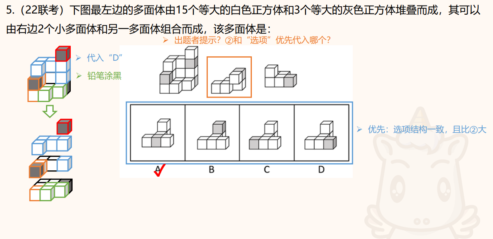
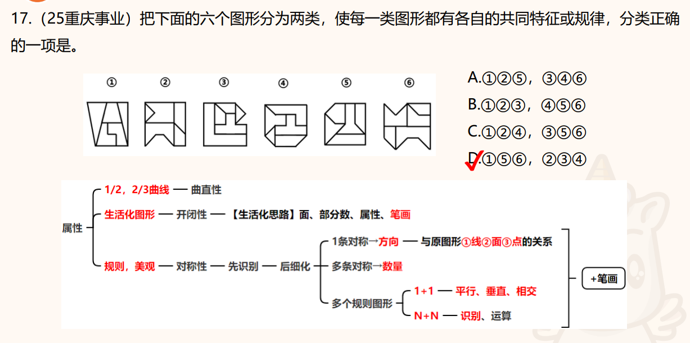
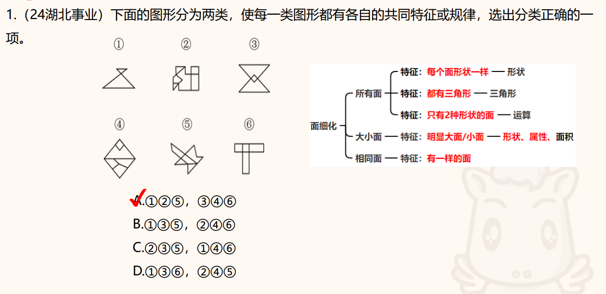

# 图形推理错题重要题薄弱题

## 1. 曲直性——曲直交点

   <Badge type="tip" text="薄弱题" />

   <Badge type="danger" text="错题" />

* 知识点

   对称性之外，曲直性排第二。

* 特点

   1/2或者2/3的图形有曲线，就要去考虑曲直性。

* 方法：

   观察曲线或直线是否每副图都有，只有一些图有的话，可能只是考查曲直性的性质（哪些图有曲线，哪些图没有），全部图形都有曲线+直线的话：1. 分别数曲线和直线的数量；2. 数曲直交点

   这道题是曲直交点的问题，分别是6、9、6、6、9、9。

* 做错原因

   拿到题就去数面的数量了，没数出来影响了判断，一时之间找不到考察点。

   

## 2. 1黑+多白模型——

### 单一规律

<Badge type="important" text="重点题" />

* 知识点

    1黑+多白模型分为三个考点：对称、形状、图形关系（按顺序去看）

    对称：就看黑块是否对称图形、外框是否轴对称图形、白块之中是否有对称图形，如果存在对称，看对称轴（中心对称的话就只考虑性质）是否存在关系（平行、垂直、相交）。

    形状：看黑块与外框、黑块与白块、白块和外框之间是否存在形状形同或者相似。

    图形关系：黑面和外框的关系——相交于几条线；黑面与白面的关系——相邻几个面、相交与几条线。

* 特点
  
    图形中有黑块和若干白块。（咱就是说，有没有可能单独考查白面的数量关系）

* 方法

    如上知识点，这道题是考查黑块与白块的关系——相交了两条边。

### 复合规律

<Badge type="important" text="重点题" />

<Badge type="warning" text="薄弱题" />

* 知识点

单一规律无法找到的话，考虑复合规律。

黑块边数与白块边数的数量规律、黑块边数与相交白块个数的数量关系....

反正就是把单个图形规律过一遍，找他们之间的数量关系。

* 特点

图形中有黑块和若干白块。

* 方法

因为黑块是特殊的显眼的，所以先看黑块的图形属性（形状、数量），没有特殊规律的话，去看白块个数、黑白相交个数、黑块与外框相交边数...

这道题就是与黑块相交的白块个数与黑块边数相等。

## 3. 立体拼合

<Badge type="warning" text="薄弱题" />

* 知识点

    立体拼合：给出整体图形和部分分体图形，把已知立方体代入整体中看，然后再拼出缺失的部分。

* 特点

    几个分块组成一个整块

* 方法

    找比较有特征的分体图拼到总图中，特征主要有：**黑块位置有特色的**、**边最长的**、**在总图中有明显对应的**。

    首先第一幅图：黑块边上有两个白块，将其放到图中可以看到，只有左边的黑块可以容纳。

    第二幅图：有一个长L形，而第一幅图中的黑块对角正好有一个空位，所以第二幅图填满的是底部区域。

    待选图的黑块就可以知道，它的黑块边有三个白块，只有a符合。

* 做错原因

    没找到拼图的方法，在乱拼。

    

## 4. 对称性

<Badge type="important" text="重点题" />

* 知识点

对称性一定是大哥！！！

图形没有对称性、或者对称性规律不行再去考虑其他的。

* 特点

题干图形每副图都有对称图形

* 方法

直接观察给出图案中是否存在对称图形，包括外框、内部图形。有对称图形一定要去看对称性。

如果是外框或只有一个对称图形，把对称轴画出来（方便对比方向）。

如果是有多个对称图形的（先看数量有没有规律），也把对称轴画出来。对比方向、相交等特点。

## 5. 最大最小面

   <Badge type="tip" text="薄弱题" />

   <Badge type="danger" text="错题" />

* 知识点

最大面/最小面的形状（三角形、四边形）、属性（对称）、面积（占比）。

* 特点

一眼看到有些面特大，有些面特小就是最大面/最小面

* 方法

观察最大面/最小面的形状、属性、面积

