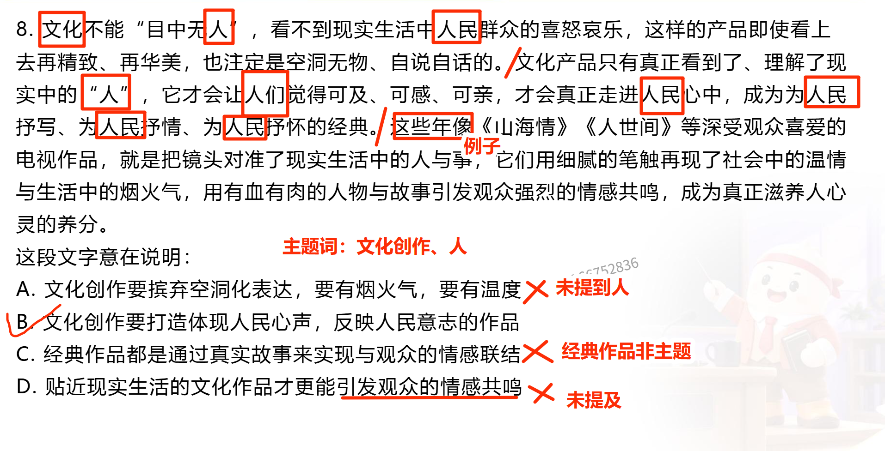
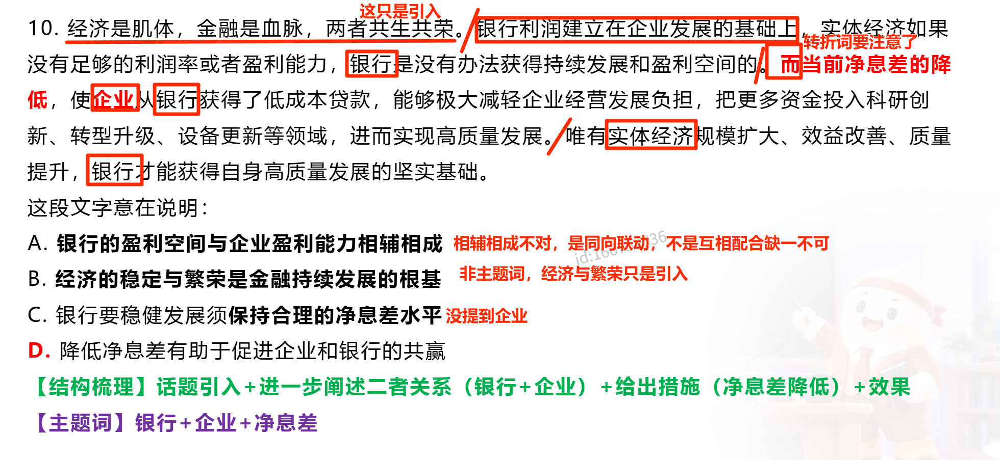
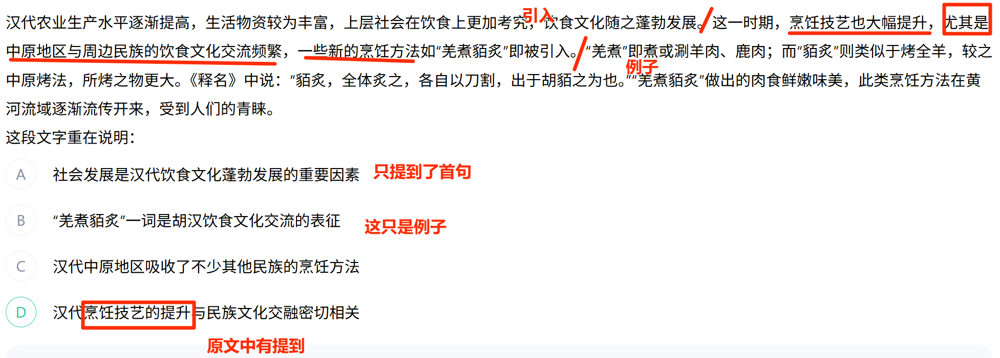

# 中心理解错难

## 1. 漏主题词（文化产品+人）

   <Badge type="tip" text="薄弱题" />

   <Badge type="danger" text="错题" />

* 知识点

    逐句分析得到主题词；例子中的词语一般不是主题词。

* 方法

    主题词很明显有一个：文化产品。还有个主题词——人，在文段中出现很频繁，也应当是主题词。

* 做错原因

    最开始只找到”文化产品“这个主题词，在选项中没找到合适的选项。然后关于a选项看到文段有表述，就选了a。

* 反思

    注意文段中那些是例子，例子中的语句词语一般不是主题。

    

## 2. 未找准主题词（银行+企业）

   <Badge type="tip" text="薄弱题" />

   <Badge type="danger" text="错题" />

* 知识点

    首句可能不含主题词，要关注后面文段在论述什么。

* 方法

    逐句分析，找到每个句子在说什么。一步一步发现主题词。发现后面文段都在说银行和企业的事，所以主题词一定有**银行、企业**。

* 做错原因

    看了第一句话，就觉得主题词是金融和经济，就先把b带入为答案了。没有着重理解后面文段的表述。后面文段都在提银行的盈利和企业的盈利。另外d选项（正确答案）看到了“降低净息差”以为文中没提到，并且这个措施太具体，就排除了。

* 反思

    逐句分析，不要先入为主就代入了。

    

## 3. 找准重点论述

  <Badge type="tip" text="薄弱题" />
<Badge type="important" text="重点题" />
   <Badge type="danger" text="错题" />

* 知识点

    “...同样是/亦是如此/也是”句式中，新概念往往是重点

* 方法

   找准“...同样是/亦是如此/也是”这样的关联词，找准文段重点论述什么。

* 做错原因

    在d与c之间纠结了一下，觉得后文都在论述那种具体的烹饪方法，所以就觉得c选项合适。但是这个烹饪方法只是例子，不足信，中心句是烹饪技艺提升与文化交流那一句。

* 反思

    找准文段在论述什么，不要把例子看得很重要。

    
