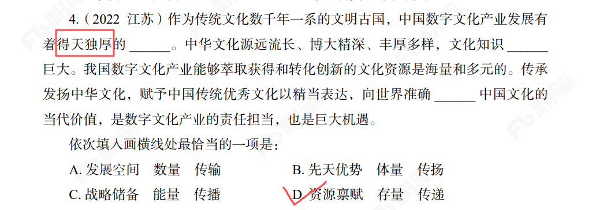
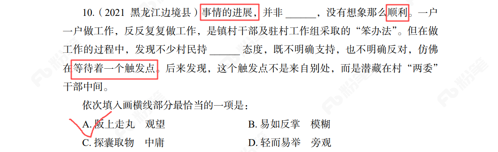
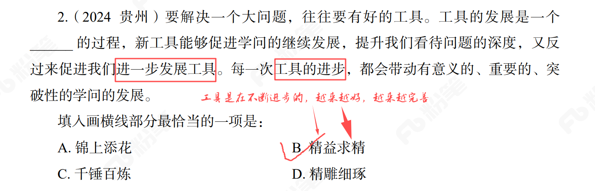

# 逻辑填空错难重薄整理

## 1. 前文语义重复

   <Badge type="danger" text="错题" />
   <Badge type="warning" text="薄弱题" />

* 知识点

与前文词语语义重复

* 方法

代入到原文中读一遍，就可以发现不对劲了。“得天独厚的先天优势”明显不对。

* 做错原因

第一遍读的时候代入选项就锚定了这个选项“先天优势”，没有代入文中做验证

* 反思

选择选项后代入到文中做验证。

## 2.不熟悉的词语/成语

<Badge type="important" text="重点题" />
<Badge type="warning" text="薄弱题" />

   <Badge type="danger" text="错题" />
* 知识点

遇见选项中有不熟悉的词语/成语，不要排除，先保留待选。

* 方法

二者并行

1. 可以使用排除法，看看其他选项是否适合，探囊取物、易如反掌、轻而易举都是说明事情很容易，不是说事情很顺利。

2. 多个空看看后面的空怎么填，提到了在等待一个触发点，所以空格处词语应该有等待的意思，就只有观望了。

* 做错原因

不熟悉“阪上走丸”的意思，先就把他排除了。后面做其他空填空的时候就只在bd两个中进行选择。

* 反思

遇见不熟悉词语或者成语，不要排除，保留下来待选，根据后续情况再做决定。

## 3. 未理解文段意思

<Badge type="important" text="重点题" />
<Badge type="warning" text="薄弱题" />

   <Badge type="danger" text="错题" />

* 知识点

空格内的词语在本句内没有明显的对应时，就应该从整个文段出发去选择词语了。

* 方法

在本句内没有对应，通读整个文段理解其意思。然后根据其选择词语。很明显文段意思说了“工具在不断进步”，所以是指工具越来越好，对应精益求精。

* 做错原因

这道题之前就做错过。这里想到的是工具在不断迭代、不断打磨，所以选了“精雕细琢”。其实文段中有很明显的句子说了“工具在不断进步”。

* 反思

不要拿着半截就开跑，文段中看到的重点语句画出来作参考。

