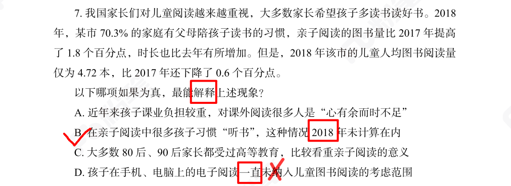
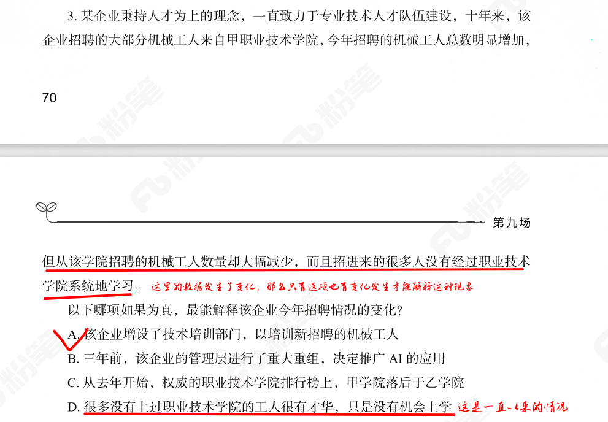
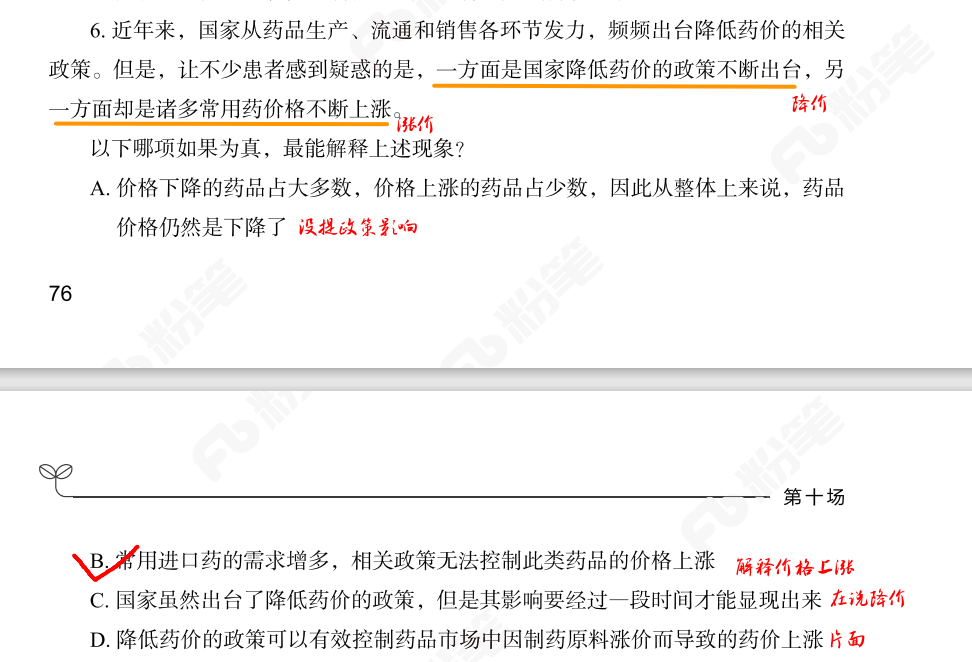
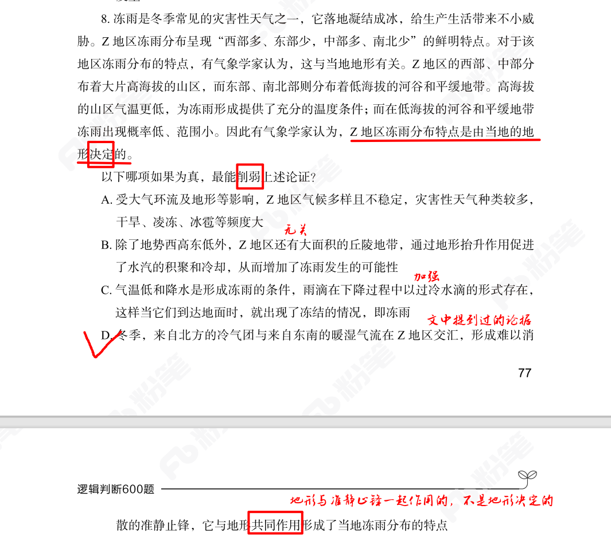

# 原因解释题

## 1. 变化才能解释变化

* 知识点

原因解释题中，常常给出一个现象：某个数据提高了，但是与之相关的数据却降低了。设问解释这种现象。

* 做法

1. 排除选项中说的“一直”这种意思的选项，因为数据产生了变化，所以就只有选项中有变化才能解释这种变化。

2. 注意时间点，时间也很关键，选项跟题干的时间对不上也解释不了。

3. 题干中提到不降反升的，导致升的原因才是重点

* 做错原因

不知道这个理论

## 2. 削弱题型+文段话题一致

* 知识点

削弱题型+文段中的论据与论点话题一致，那么就要考虑从论点出发进行削弱了。

两种方式：1. 直接否论点。2. 否定论点的核心要素

否定核心要素要注意一些关键词：**决定、主要原因是、根本原因是、取决于**。从这些词出发观察有没有选项能从这些方面去削弱。

削弱“由X决定”，看看选项中有没有“X不是唯一的、决定性成因”这样的选项。

* 做法

浏览选项，注意选项中有没有直接对论点的的否定，没有的话要注意有没有对论点核心要素的否定。

比如本题，论点是“Z地区冻雨分布特点是由当地的地形决定的”。这个“决定”就有一点绝对，可以从这里出发。

误选C选项，但是C选项提到的就是文段论据中的东西，所以就是加强不是削弱。并且他也没提地形，不能妄加揣测。

