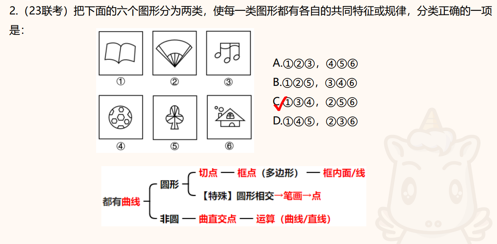
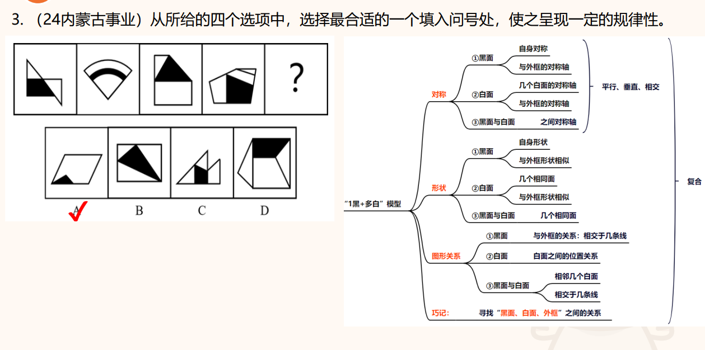
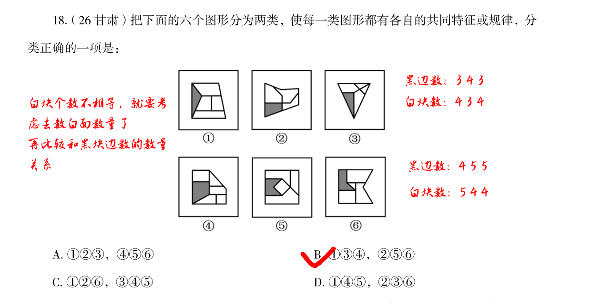
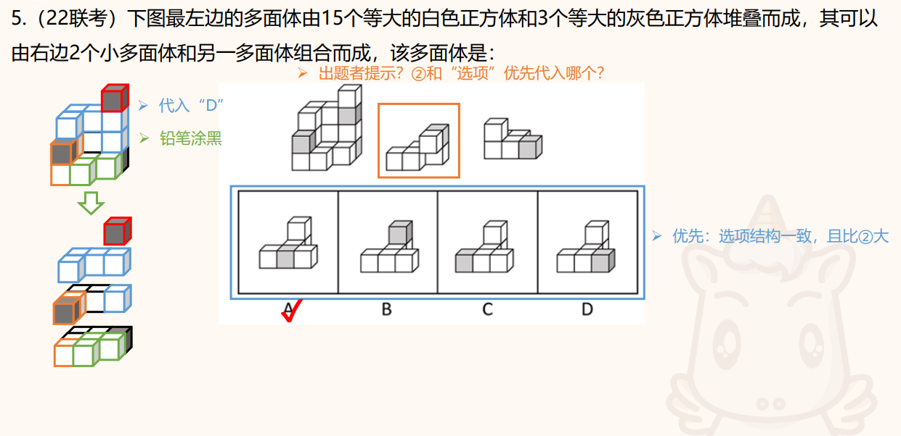
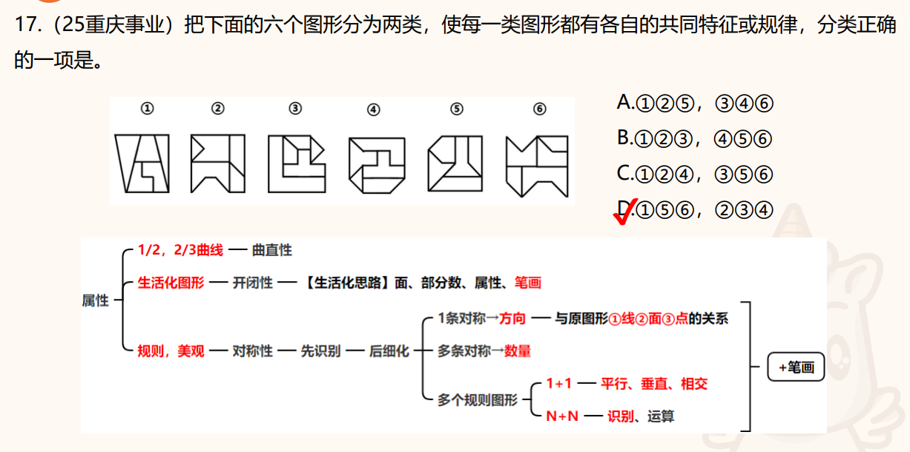
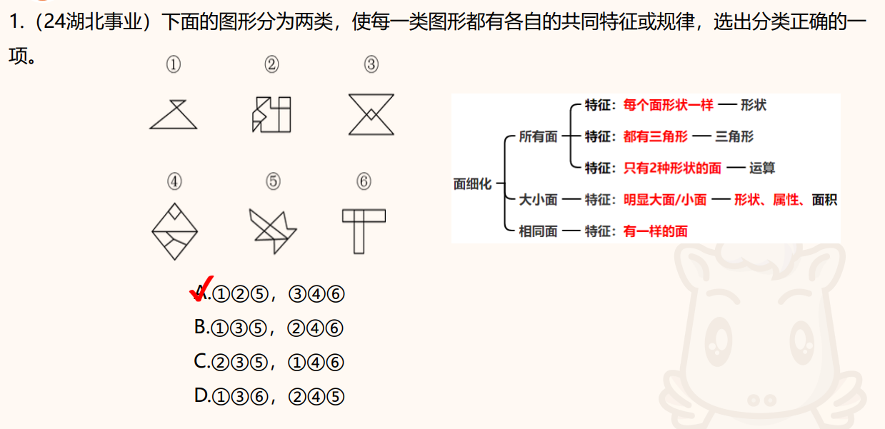
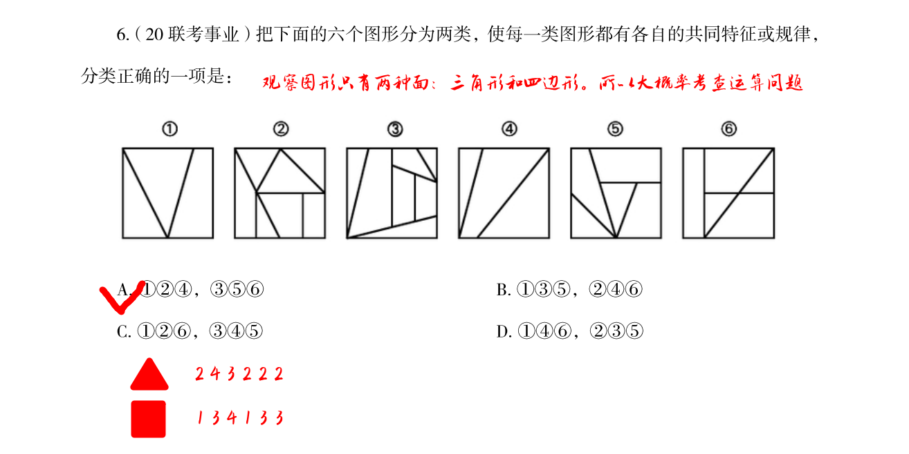
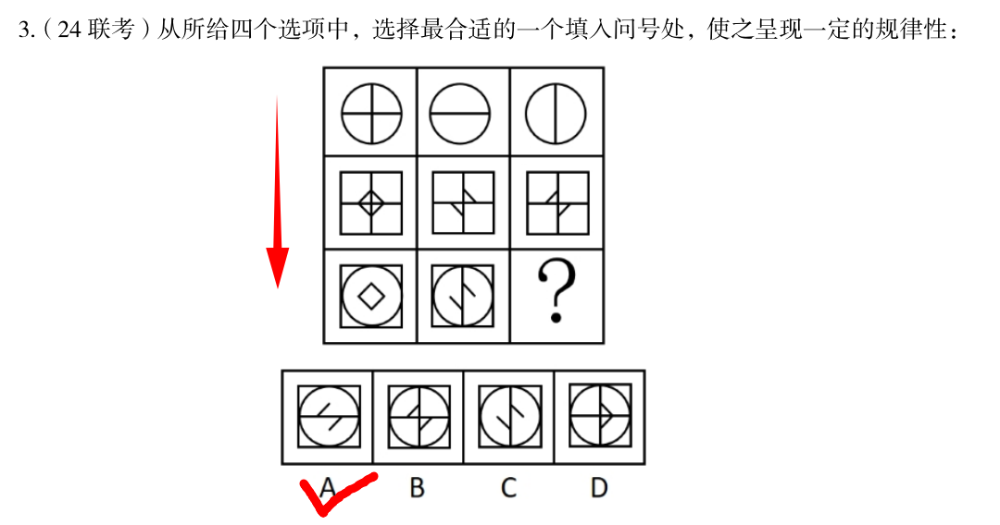
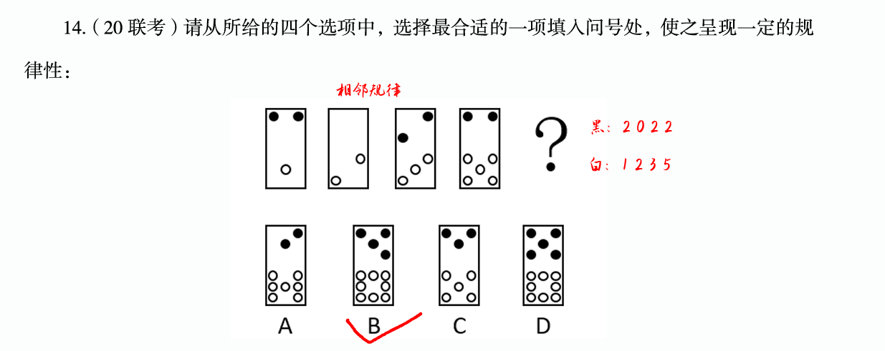
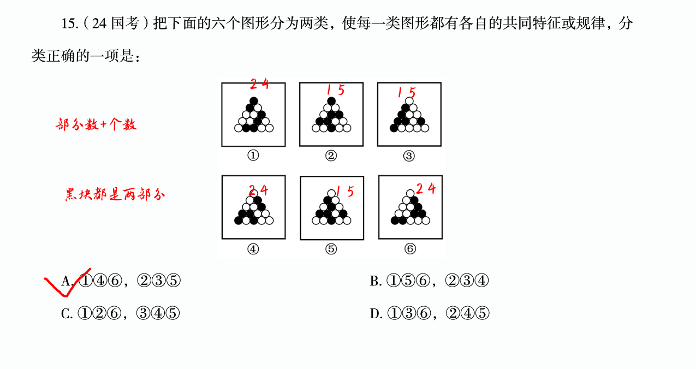

# 图形推理错题重要题薄弱题

<WhisCards>

## 1. 曲直性——曲直交点

* 标签：薄弱题 错题

* 知识点：

   对称性之外，曲直性排第二。

   1/2或者2/3的图形有曲线，就要去考虑曲直性。

* 方法：

   观察曲线或直线是否每副图都有，只有一些图有的话，可能只是考查曲直性的性质（哪些图有曲线，哪些图没有）。

   全部图形都有曲线+直线的话：1. 分别数曲线和直线的数量；2. 数曲直交点

   这道题是曲直交点的问题，分别是6、9、6、6、9、9。

* 错因：

   拿到题就去数面的数量了，没数出来影响了判断，一时之间找不到考察点。

* 反思：1111

* 题目：

## 2. 1黑+多白模型

### 单一规律

* 标签：重点题

* 知识点：

    1黑+多白模型分为三个考点：对称、形状、图形关系（按顺序去看）

    对称：就看黑块是否对称图形、外框是否轴对称图形、白块之中是否有对称图形，如果存在对称，看对称轴（中心对称的话就只考虑性质）是否存在关系（平行、垂直、相交）。

    形状：看黑块与外框、黑块与白块、白块和外框之间是否存在形状形同或者相似。

    图形关系：黑面和外框的关系——相交于几条线；黑面与白面的关系——相邻几个面、相交与几条线。
  
* 特点：**图形中有黑块和若干白块就要考虑这个点**。（咱就是说，有没有可能单独考查白面的数量关系）

* 方法：如上知识点，这道题是考查黑块与白块的关系——相交了两条边。

* 反思：111

* 题目：

### 复合规律

* 标签：重点题 薄弱题

* 知识点：

    单一规律无法找到的话，考虑复合规律。

    黑块边数与白块边数的数量规律、黑块边数与相交白块个数的数量关系....

    反正就是把单个图形规律过一遍，找他们之间的数量关系。

* 特点：**图形中有黑块和若干白块就要考虑这个**

* 方法：

    因为黑块是特殊的显眼的，所以先看黑块的图形属性（形状、数量），没有特殊规律的话，去看白块个数、黑白相交个数、黑块与外框相交边数...

    这道题就是与黑块相交的白块个数与黑块边数相等。

* 反思：111

* 题目：

### 白块数量不相等

* 标签：重点题 薄弱题

* 知识点：

    1黑+多白的复合规律，如果图中的白块数量不相等，就要考虑去数白面的数量，和黑面的属性（如边数）进行比较了

    为什么这里不和外框进行比较呢？我想大概是，白面数量不一样的话，是出题人故意设计的吧，把方向往这方面引。

* 特点：**白面数量不相等就要考虑这个点**

* 做法：

    把每个图中的白面数量数出来，和黑面的属性（比如边数）进行对比。

* 反思：111

* 题目：

## 3. 立体拼合

* 标签：薄弱题

* 知识点：

    立体拼合：给出整体图形和部分分体图形，把已知立方体代入整体中看，然后再拼出缺失的部分。

* 特点：

    几个分块组成一个整块

* 方法：

    找比较有特征的分体图拼到总图中，特征主要有：**黑块位置有特色的**、**边最长的**、**在总图中有明显对应的**。

    首先第一幅图：黑块边上有两个白块，将其放到图中可以看到，只有左边的黑块可以容纳。

    第二幅图：有一个长L形，而第一幅图中的黑块对角正好有一个空位，所以第二幅图填满的是底部区域。

    待选图的黑块就可以知道，它的黑块边有三个白块，只有a符合。

* 错因：

    没找到拼图的方法，在乱拼。

* 题目：

## 4. 对称性

* 标签：重点题

* 知识点：

    对称性一定是大哥！！！

    图形没有对称性、或者对称性规律不行再去考虑其他的。

* 特点：

    题干图形每副图都有对称图形

* 方法：

    直接观察给出图案中是否存在对称图形，包括外框、内部图形。有对称图形一定要去看对称性。

    如果是外框或只有一个对称图形，把对称轴画出来（方便对比方向）。

    如果是有多个对称图形的（先看数量有没有规律），也把对称轴画出来。对比方向、相交等特点。

题目：

## 5. 最大最小面

* 标签：薄弱题 错题

* 知识点：

    最大面/最小面的形状（三角形、四边形）、属性（对称）、面积（占比）。

* 特点：

    一眼看到有些面特大，有些面特小就是最大面/最小面

* 方法：

    观察最大面/最小面的形状、属性、面积

* 题目：

## 6. 只有两种图形考查运算

* 标签：薄弱题 重点题

* 知识点：

    图形中有多个图形，观察后只有两种图形，大概率是考查运算问题（图形个数进行运算）

* 方法：

    面数较多，观察后发现只有三角形和四边形，分别去数两种图形的个数，观察他们之间的数量关系得到答案就是a了

* 题目：

## 7. 九宫格竖向的看

* 标签：薄弱题 重点题

* 知识点：

    九宫格找规律优先看横向，横向不能发现规律往竖向去看。

    另外，看起来是加减同异的，但是有一部分不满足，那就不是加减同异，**加减同异**一定是整体都满足的。

* 方法：

    横向不满足条件，直接就竖向找规律，不要犹豫。

* 题目：

## 8. 相邻比较

### 黑白分开看+个数相加等于下一个

* 标签：错题 难题 薄弱题

* 要点：

    分别出现黑白块，要分开看。

    先看对称性，明显没有规律。

    考虑数量规律，本身数量没有规律，要考虑相邻规律。相邻来看的话，前后对比也没有规律。

    **再从运算规律去看**，发现1+2=3。

* 特点：没有递增、递减等规律，就要去看运算规律了。

* 方法：

    1. 看见黑白块分开的，就去分别把个数标出来。

    2. 对比数量规律，相邻没有数量规律就去运算。

    3. 发现黑块：2+0=2、0+2=2,那么得到2+2=4；白块：1+2=3、2+3=5,那么得到3+5=8 。

* 错因：把数字标出来了，没往前后相加的方向去考虑。

* 反思：把思路整理一下，一条路不通往另一个方向去考虑。

* 题目：

## 9. 部分数+个数的复合考点

* 标签：重点题

* 要点：近两年都爱考复合规律，**部分数+个数**的复合尤其注意。

* 特点：堆数一样、总个数一样

* 方法：分别去数两堆的个数，再看规律

* 题目：

</WhisCards>
