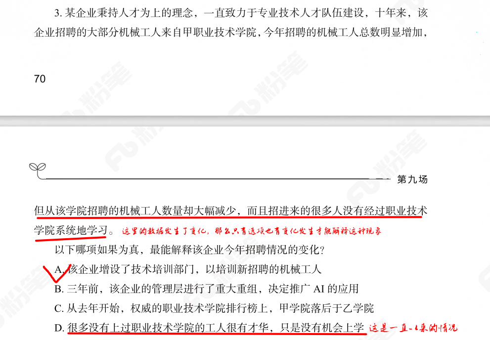

# 真假推理错题

<WhisCards>

## 1. 最不能质疑/加强题目

### **行程问题**（相遇追及）

* 标签：薄弱题 重点题

* 要点：

    相遇与追及，路程 = 速度 × 时间

    相遇与追及，路程 = 速度 × 时间

    相遇与追及，路程 = 速度 × 时间

    相遇与追及，路程 = 速度 × 时间

* 方法：画线段图，分阶段设未知数

* 错因：忽略了**相遇后继续行驶**的时间

* 反思：运动过程要分阶段

* 题目：

</WhisCards>
