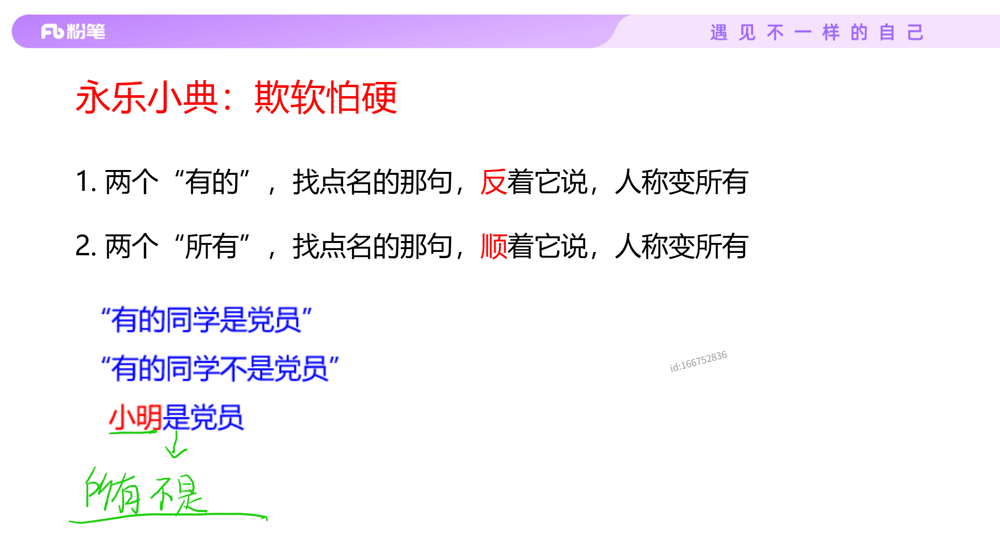
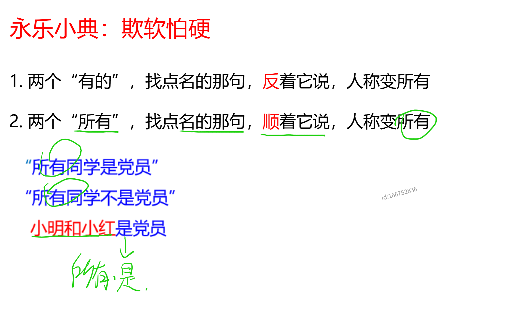

# 真假推理

题型概述：题目给出若干陈述（通常是2-4个人说的话），并告知其中有几句真话、几句假话，要求判断真实情况。

真题考察中通常考察对于**矛盾关系**的辨识，即当A→B时，A且-B场景的识别能力。

> [反对关系](./逻辑推理.md/#反对关系)和[下反对关系](./逻辑推理.md/#下反对关系)都可以作为此类题型的破题点。（比较少见）

真假话的推理起点，是对条件本身的矛盾推理和识别。有以下几种转换：

1. 是A 的矛盾为：不是A。

2. 所有的A都是B 的矛盾为：有的A不是B。

3. A或B 的矛盾为：-A且-B。

4. 如果A则B 的矛盾为：在A成立的基础上，B不成立（如果A不成立，则该条件恒真）

## 解题步骤

1. 寻找体感表述矛盾

2. 根据矛盾关系分配真话或假话的“名额”

3. 锁定真假话范围后，结合其他条件进行推理，获得确定性结论

## 具体题型

* 以矛盾为起点推理型

识别题目问法与条件之间的矛盾起点，并依次递推。

最常见的为罗素悖论——自指矛盾。

* 选项信息充足型

代入选项查看

* 只有一真/一假题型

题干中只有一句真话/假话，需要找到互相矛盾的两个命题，锁定真/假话范围。

只有一真的话，那找到矛盾的选项后，其余选项就是假的；只有一假的话，那找到矛盾的选项后，其余选项就是真的。

* 两真两假题型

也是寻找矛盾关系。

* 半对半错题型

一个人的话对一半，错一半。

方法：

可以选项代入，可以带入第一句话的第二个陈述。

## 36计真假推理——找矛盾

### 常见题型

矛盾关系：

1. A与-A

2. 所有A都是B 与 有的A不是B为矛盾关系；所有A都不是B 与 有的A是B为矛盾关系

3. A → B的矛盾关系为 A且-B

4. A且B 的矛盾关系为 -A或-B；A或B 的矛盾关系为 -A且-B（德摩根定律）

反对关系

1. 有的是 与 有的不是 **必有一真**（下反对关系）；所有都是 与 所有都不是 **必有一假**（反对关系）。

### 永乐小典

1. 两真两假的题目，出现了两个矛盾要素，一个是A或B条件，一个是单个元素A，那么单个元素的一定是假。

2. 有的是 与 有的不是 **必有一真**（下反对关系）；所有都是 与 所有都不是 **必有一假**（反对关系）。

3. 两个“有的”，找点名那句，**反**（是变不是，不是变是）着他说，人称变所有；两个“所有”，找点名那句，**顺**（是还是是，不是还是不是）着他说，人称变所有。
   
   

4. A或B 与 -A，必有一真；A且B 与 -A，必有一假。

5. 冠军模型：只有一个冠军，问题里面提到了几个是真的，那么冠军就出现了几次。
