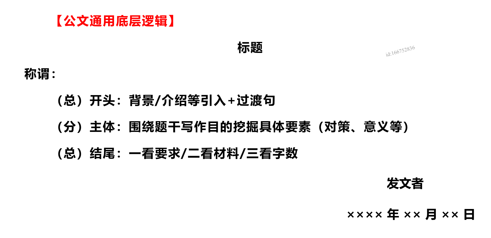
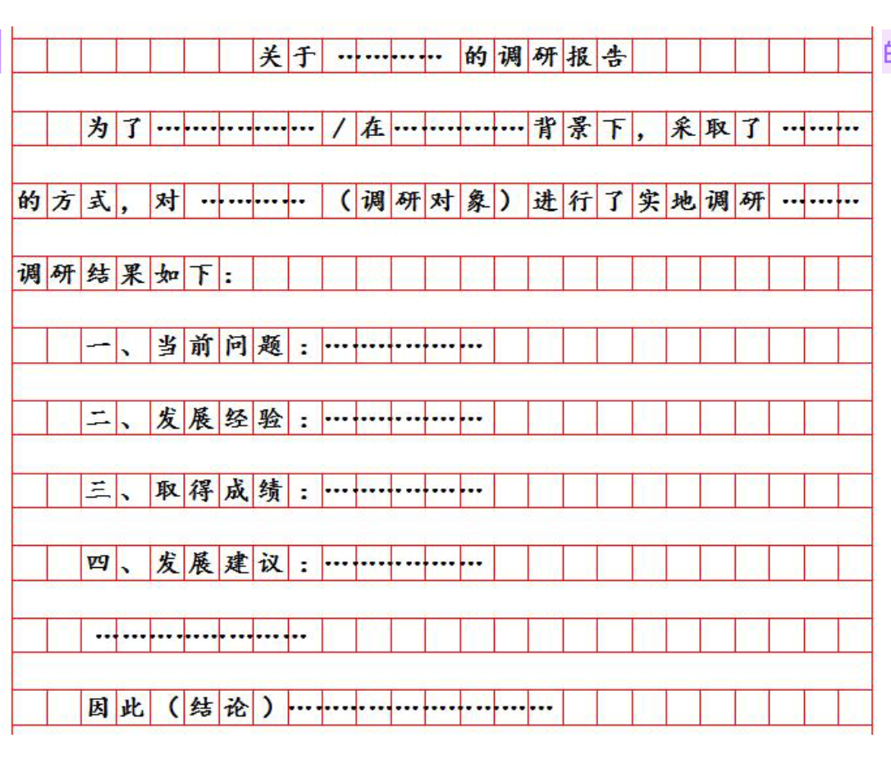
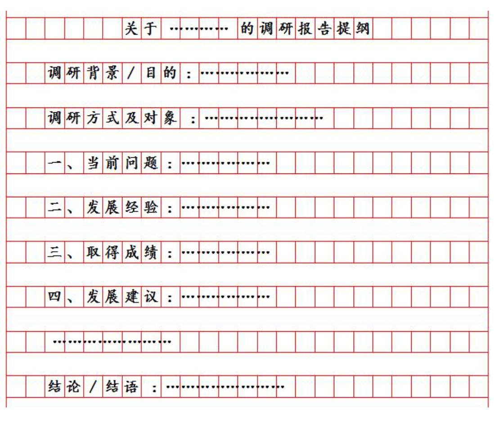

# 公文

核心还是要尊重材料！！！材料永远是第一位的。

## 答题格式

申论整体的写作格式见[申论写作格式](../写作格式.md)

不同文种对应不同格式。

公文题都有差不多的通用写作格式，如下：

标题：第一行居中写。

称谓：第二行顶格写，就是面向对象。

落款——发文者：写这篇文章的身份，根据材料中来，不可暴露真实信息。

落款——时间：可以用 xxxx年xx月xx日 来代替，请注意，每两个数字占一个格子，右边空四个格子。

内容：分为三个部分，开头（背景/介绍等引入+过渡句）、主体（根据题干挖掘具体要素，对策、意义等）、结尾（一看要求：有感染力、有号召力，需要写结尾；二看材料：材料中有总结性语言，就要写结尾；三看字数：字数没达标，就要写结尾凑字数，没有字数来写结尾了就不写）。三个部分首句空两格。

写作格式：

公文题必须分段，可以分为三段（背景、经验、结尾）。

标序号选择大写的一二三。

> 过渡句万能句：**具体介绍如下：**

> 对策题目中不写数字，公文题中可以写数字

## 答题方法

公文题与对策题一样，文章需要读多遍，第一遍通读梳理要点，第二遍精读提取信息组织答案。

公文题还要多读一遍：打草稿、列提纲。这一部分，主要就是梳理第二遍精读提取信息后的逻辑提取。

## 内容要素

## 逻辑分类

跟对策题一样保持一致，尽量从材料中提取信息、词语、逻辑。

跟对策不一样的是，公文题前置词尽量都写。

## 公文分类

### 1. 讲话稿/发言稿/讲话提纲/发言提纲

#### 讲话稿/发言稿

这一类听名字就比较正式一点

格式：标题+称谓；不需要落款

内容：结合应用场景，开头可以寒暄：“大家好，非常荣幸...”等，不可过长，一句话即可；结合应用场景，材料中有生动形象的表达，可以直接抄在答案中，无需概括规范词。

#### 讲话提纲/发言提纲

这一类就没那么正式了。

格式：标题（不需要称谓、落款）

内容：保险起见，提炼出“要素信息”作为小标签前置，呈现纲目式。

何为要素信息：就是你这一段文字在写什么，比如在写背景，就在第一段前写一个“背景：”作为小标签。通常写背景、经验/成绩/建议、结语三部分。

### 2. 调研报告/调研报告提纲

格式：只有标题（不要称谓、落款），写法为“关于...的调研报告”

内容：符合一般公文的逻辑，开头——主体——结尾。

开头：背景/目的+调研方式、调研对象+过渡句

主体：按阶段分条写，注意标记小标签，比如“一、当前问题....二、发展经验....”。主体每一条都要分段。

结尾：得出结论

如果是提纲的话，小标签就需要改一下，见下图。

通用格式如下（主体部分内容取决于材料）：

**调研报告**：

**调研报告提纲**

