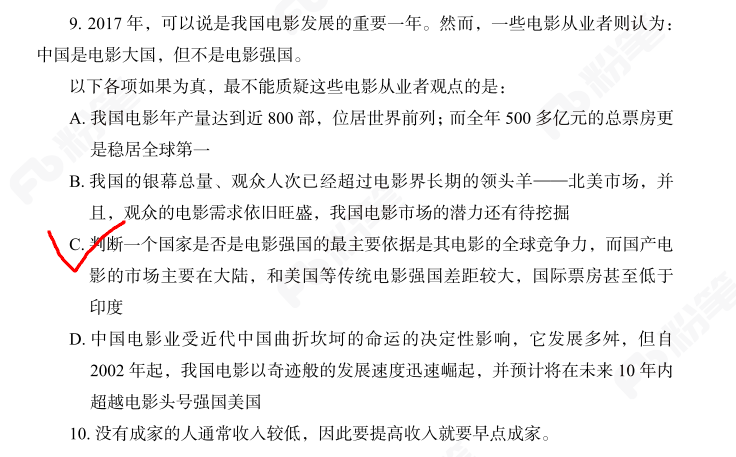
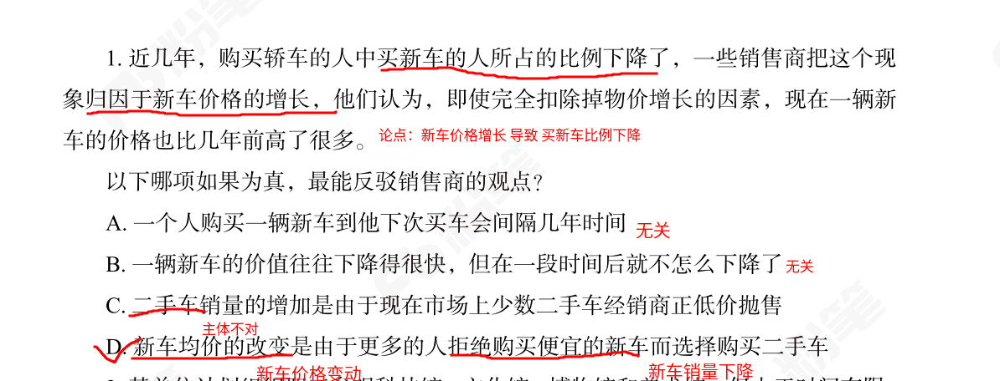

# 加强削弱题型

## 1. 最不能质疑/加强题目

* 最不能质疑

   <Badge type="tip" text="薄弱题" />

   <Badge type="danger" text="错题" />

  * 知识点

    这类题目最不能质疑，意思即是其他选项都能削弱论点，选一个不能削弱论点的选项，其实相当于加强题。

  * 方法

    论点出现了转折词：中国是电影大国，但不是电影强国。重点一定是转折词后面的句子，即：中国不是电影强国。那么它的削弱应该是：中国是电影强国。

    使用排除法：看选项，能削弱论点的肯定不选。加强项/无关项都可以选择。

    a选项：中国是电影强国。削弱选项。

    b选项：中国很强了，后面还会更强，削弱选项

    c选项：中国电影不强，还没印度强。加强选项

    d选项：2002年已经快速崛起了，并且2002年之后的十年内超越电影头号强国美国。题干中的时间是2017年，说明中国已经变成电影强国了。削弱选项

  * 做错原因

    中途想岔了。想到削弱题去了。

  * 反思

    做这种题先把题干要求写出来，最不能质疑 即是 加强题。在选项旁边写出这个选项是加强还是削弱。

    

## 2. 因果+削弱+论点不明显

<Badge type="tip" text="薄弱题" />

<Badge type="danger" text="错题" />

* 知识点

    一、因果+削弱类题目，一般考查的是他因与因果倒置两个因素

    二、论点不明显，一定要从题干中梳理出来论点，不然后面的做题一定是徒劳无功的

* 方法

    从题干中梳理论点得到 新车价格增长 导致 买新车比例下降

    直接观察选项有没有他因与因果倒置的表述。

    可以看到，只有d选项同时提到了价格变动和销量变动。

    a选项指示客观常态，一直存在无法反驳近几年占比下降。

* 做错原因

    没找到题目中的论点，导致选项纠结不定。

* 反思

    加强削弱一定要从题干中找到论点之后才进行选择。没有论点，就是无根之水，无处下嘴。

