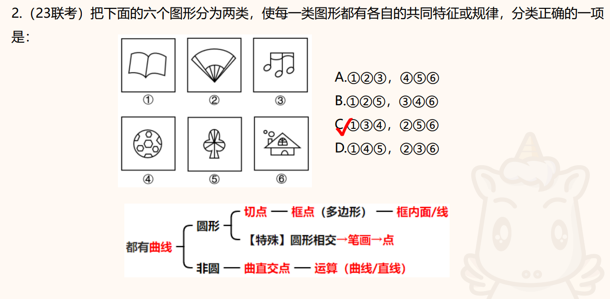

# 图形推理错题本

1. 曲直性

   * 知识点

   对称性之外，曲直性排第二。

   * 特点

   1/2或者2/3的图形有曲线，就要去考虑曲直性。

   * 方法：

   观察曲线或直线是否每副图都有，只有一些图有的话，可能只是考查曲直性的性质（哪些图有曲线，哪些图没有），全部图形都有曲线+直线的话：1. 分别数曲线和直线的数量；2. 数曲直交点

   这道题是曲直交点的问题，分别是6、9、6、6、9、9。

   * 做错原因

   拿到题就去数面的数量了，没数出来影响了判断，一时之间找不到考察点。

   <Badge type="info" text="tip" />
   <Badge type="info" text="danger" />
   

2. 1黑+多白模型

* 知识点

1黑+多白模型分为三个考点：对称、形状、图形关系（按顺序去看）

对称：就看黑块是否对称图形、外框是否轴对称图形、白块之中是否有对称图形，如果存在对称，看对称轴（中心对称的话就只考虑性质）是否存在关系（平行、垂直、相交）。

形状：看黑块与外框、黑块与白块、白块和外框之间是否存在形状形同或者相似。

图形关系：黑面和外框的关系——相交于几条线；黑面与白面的关系——相邻几个面、相交与几条线。

* 特点
  
图形中有黑块和若干白块。（咱就是说，有没有可能考查白面的数量关系）

方法：如上知识点

<Badge type="warning" text="重点题" />

